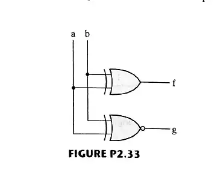
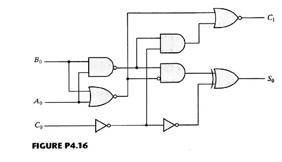

@quiz id="digital-systems-ch1-ch4-textbook-exercises" revision="1" subject="數位系統導論" tags="textbook-exercises,number-systems,boolean-algebra,karnaugh-map,gate-level-minimization,combinational-logic" estimatedMinutes="360" current="true"
# 【課本習題】數位系統導論 Ch1 ~ Ch4

依據課本 Chapter 1～4 習題中指定題號整理，涵蓋數制與編碼、布林代數、K-map 與閘級化簡、組合邏輯、解碼器與多工器等主題。題目與各小題維持來源英文與原始數學表示；請寫出必要推導、真值表或電路設計，可使用文字輸入或手寫作答。

:::question id="q01" type="calculation" points="5" tags="number-systems,base-conversion"
### Problem 1.9

Express the following numbers in decimal:

(a) $(10101.101)_2$

(b) $(64.8)_{16}$

(c) $(261.44)_8$

(d) $(51DE.C)_{16}$

(e) $(110011.001)_2$

:::drawing
width=1200
height=900
:::answer
(a) $21.625$

(b) $100.5$

(c) $177.5625$

(d) $20958.75$

(e) $51.125$
:::solution
核對上列答案。
:::rubric
- 5 | 正確答案與必要過程。
:::end

:::question id="q02" type="calculation" points="4" tags="number-systems,base-conversion"
### Problem 1.13(a)

Convert decimal 45.125 to binary.

:::drawing
width=1200
height=900
:::answer
$(45.125)_{10}=(101101.001)_2$
:::solution
核對上列答案。
:::rubric
- 4 | 正確答案與必要過程。
:::end

:::question id="q03" type="calculation" points="8" tags="binary-arithmetic,twos-complement"
### Problem 1.18

Perform subtraction on the given unsigned binary numbers using the 2's complement of the subtrahend. If the result of subtraction is negative, its decimal equivalent is formed by taking the 2's complement of the result and including a minus sign.

(a) $11001-10010$

(b) $1100-11110$

(c) $10101-11011$

(d) $1100011-10001$

:::drawing
width=1200
height=900
:::answer
(a) $00111_2=7$

(b) $-10010_2=-18$

(c) $-00110_2=-6$

(d) $1010010_2=82$
:::solution
核對上列答案。
:::rubric
- 8 | 正確答案與必要過程。
:::end

:::question id="q04" type="calculation" points="10" tags="twos-complement,binary-arithmetic"
### Problem 1.20

Convert decimal +49 and +29 to binary, using the signed-2's-complement representation and enough digits to accommodate the numbers. Then perform the binary equivalent of $(+29)+(-49)$, $(-29)+(+49)$, and $(-29)+(-49)$. Convert the answers back to decimal and verify that they are correct.

:::drawing
width=1200
height=900
:::answer
Using 7-bit signed 2's-complement:

$+49=0110001$, $+29=0011101$, $-49=1001111$, $-29=1100011$.

$(+29)+(-49)=1101100=-20$.

$(-29)+(+49)=0010100=+20$.

$(-29)+(-49)=0110010$ with overflow; the mathematical result is $-78$, which is outside the 7-bit signed range.
:::solution
核對上列答案。
:::rubric
- 10 | 正確答案與必要過程。
:::end

:::question id="q05" type="calculation" points="10" tags="bcd,ascii,parity"
### Problem 1.22

Convert decimal 9,045 and 337 to both BCD and ASCII codes. For ASCII, an even parity bit is to be appended at the left.

:::drawing
width=1200
height=900
:::answer
BCD:

$9045\rightarrow1001\ 0000\ 0100\ 0101$

$337\rightarrow0011\ 0011\ 0111$

ASCII with the even-parity bit at the left:

$9045\rightarrow00111001\ 00110000\ 10110100\ 00110101$

$337\rightarrow00110011\ 00110011\ 10110111$
:::solution
核對上列答案。
:::rubric
- 10 | 正確答案與必要過程。
:::end

:::question id="q06" type="calculation" points="10" tags="ascii,parity,hexadecimal"
### Problem 1.30

The following is a string of ASCII characters whose bit patterns have been converted into hexadecimal for compactness: 47 2E 5C 42 CF CF CC C5. Of the eight bits in each pair of digits, the leftmost is a parity bit. The remaining bits are the ASCII code.

(a) Convert the string to bit form and decode the ASCII.

(b) Determine the parity used: odd or even?

:::drawing
width=1200
height=900
:::answer
(a)

`47 2E 5C 42 CF CF CC C5`

$\rightarrow$ `01000111 00101110 01011100 01000010 11001111 11001111 11001100 11000101`

Removing the leftmost parity bit from each byte gives the ASCII string `G.\BOOLE`.

(b) Even parity.
:::solution
核對上列答案。
:::rubric
- 10 | 正確答案與必要過程。
:::end

:::question id="q07" type="calculation" points="6" tags="boolean-algebra,simplification"
### Problem 2.3

Simplify the following Boolean expressions to a minimum number of literals:

(a) $xyz+x'y+xyz'$

(b) $x'yz+xz$

(c) $(x+y)'(x'+y')$

(d) $xy+x(wz+wz')$

(e) $(yz'+x'w)(xy'+zw')$

(f) $(x'+z')(x+y'+z')$

:::drawing
width=1200
height=900
:::answer
(a) $y$

(b) $z(x+y)$

(c) $x'y'$

(d) $x(w+y)$

(e) $0$

(f) $z'+x'y'$
:::solution
核對上列答案。
:::rubric
- 6 | 正確答案與必要過程。
:::end

:::question id="q08" type="calculation" points="6" tags="boolean-algebra,complement"
### Problem 2.9

Find the complement of the following expressions:

(a) $xyz+x'y'z'$

(b) $(x+y')(y+z')(z+x')$

(c) $w'x'+w(x+y+z)$

:::drawing
width=1200
height=900
:::answer
(a) $(x'+y'+z')(x+y+z)$

(b) $x'y+y'z+z'x$

(c) $w'x+wx'y'z'$
:::solution
核對上列答案。
:::rubric
- 6 | 正確答案與必要過程。
:::end

:::question id="q09" type="calculation" points="8" tags="truth-table,boolean-function"
### Problem 2.11

List the truth table of the function:

(a) $F=x'z'+xy+yz$

(b) $F=a'b'c'+a'bc+ab'c'+abc$

:::drawing
width=1200
height=900
:::answer
(a)

| x | y | z | F |
|---|---|---|---|
|0|0|0|1|
|0|0|1|0|
|0|1|0|1|
|0|1|1|1|
|1|0|0|0|
|1|0|1|0|
|1|1|0|1|
|1|1|1|1|

(b)

| a | b | c | F |
|---|---|---|---|
|0|0|0|1|
|0|0|1|0|
|0|1|0|0|
|0|1|1|1|
|1|0|0|1|
|1|0|1|0|
|1|1|0|0|
|1|1|1|1|
:::solution
核對上列答案。
:::rubric
- 8 | 正確答案與必要過程。
:::end

:::question id="q10" type="calculation" points="10" tags="logic-gates,implementation"
### Problem 2.14

Implement the Boolean function

$$F=x'y+xy'+xz$$

(a) With AND, OR, and inverter gates.

(b) With OR and inverter gates.

(c) With AND and inverter gates.

(d) With NAND and inverter gates.

(e) With NOR and inverter gates.

:::drawing
width=1200
height=900
:::answer
One valid set of equivalent implementations is:

(a) Direct SOP: $F=x'y+xy'+xz$.

(b) $F=(x+y')'+(x'+y)'+(x'+z')'$.

(c) $F=[(x'y)'(xy')'(xz)']'$.

(d) NAND the three first-level complements: $F=\operatorname{NAND}((x'y)',(xy')',(xz)')$.

(e) Form $x'y=(x+y')'$, $xy'=(x'+y)'$, and $xz=(x'+z')'$ with NOR gates, NOR those three terms, then invert the result.
:::solution
核對上列答案。
:::rubric
- 10 | 正確答案與必要過程。
:::end

:::question id="q11" type="calculation" points="8" tags="truth-table,karnaugh-map,simplification"
### Problem 2.15

Simplify the following Boolean functions $T_1$ and $T_2$ to a minimum number of literals:

| A | B | C | $T_1$ | $T_2$ |
|---|---|---|---|---|
|0|0|0|0|1|
|0|0|1|1|0|
|0|1|0|1|1|
|0|1|1|1|0|
|1|0|0|0|0|
|1|0|1|1|1|
|1|1|0|0|0|
|1|1|1|1|1|

:::drawing
width=1200
height=900
:::answer
$T_1=C+A'B$

$T_2=A'C'+AC$
:::solution
核對上列答案。
:::rubric
- 8 | 正確答案與必要過程。
:::end

:::question id="q12" type="calculation" points="12" tags="truth-table,canonical-form,minterms,maxterms"
### Problem 2.17

Obtain the truth table for the following four-variable functions, and express each function in sum-of-minterms and product-of-maxterms form:

(a) $(ac+b)(ab+d)$

(b) $(a'+c'+d')(ab+cd)$

(c) $(b+c'd')(a+bc')$

(d) $a'b'c'+acd+ab'd'+b'cd$

:::drawing
width=1200
height=1200
:::answer
Canonical forms:

(a) $F=\Sigma(5,7,11,12,13,14,15)=\Pi(0,1,2,3,4,6,8,9,10)$

(b) $F=\Sigma(3,7,12,13,14)=\Pi(0,1,2,4,5,6,8,9,10,11,15)$

(c) $F=\Sigma(4,5,10,12,13,14,15)=\Pi(0,1,2,3,6,7,8,9,11)$

(d) $F=\Sigma(0,1,3,8,10,11,15)=\Pi(2,4,5,6,7,9,12,13,14)$

Truth table, with columns $F_a,F_b,F_c,F_d$ corresponding to (a)–(d):

|a|b|c|d|$F_a$|$F_b$|$F_c$|$F_d$|
|---|---|---|---|---|---|---|---|
|0|0|0|0|0|0|0|0|1|
|0|0|1|0|0|0|1|
|0|0|1|0|0|0|0|0|
|0|0|1|1|0|1|0|1|
|0|1|0|0|0|0|1|0|
|0|1|0|1|1|0|1|0|
|0|1|1|0|0|0|0|0|
|0|1|1|1|1|1|0|0|
|1|0|0|0|0|0|0|1|
|1|0|0|1|0|0|0|0|
|1|0|1|0|0|0|1|1|
|1|0|1|1|1|0|0|1|
|1|1|0|0|1|1|1|0|
|1|1|0|1|1|1|1|0|
|1|1|1|0|1|1|1|0|
|1|1|1|1|1|0|1|1|
:::solution
核對上列答案。
:::rubric
- 12 | 正確答案與必要過程。
:::end

:::question id="q13" type="calculation" points="12" tags="boolean-algebra,truth-table,logic-diagram"
### Problem 2.18

For the Boolean function

$$F=w'xy+w'yz+wy'z+w'y'z+xy$$

(a) Obtain the truth table of $F$ and represent it as the sum of minterms.

(b) Draw the logic diagram, using the original Boolean expression.

(c) Use Boolean algebra to simplify the function to a minimum number of literals.

(d) Obtain the function $F$ as the sum of minterms from the simplified expression and show that it is the same as the one in part (a).

(e) Draw the logic diagram from the simplified expression, and compare the total number of gates with the diagram of part (b).

:::drawing
width=1200
height=900
:::answer
(a) $F=\Sigma(1,3,5,6,7,9,13,14,15)$.

(c) $F=xy+w'z+y'z$.

(d) The simplified expression expands to the same minterm set $\Sigma(1,3,5,6,7,9,13,14,15)$.

(e) Counting explicit inverters, AND gates, and the final OR gate, a direct implementation of the original expression uses 8 gates, while $xy+w'z+y'z$ uses 6 gates.
:::solution
核對上列答案。
:::rubric
- 12 | 正確答案與必要過程。
:::end

:::question id="q14" type="calculation" points="8" tags="canonical-form,minterms,maxterms"
### Problem 2.19

Express the following function as a sum of minterms and as a product of maxterms:

$$F(A,B,C,D)=AB'+BC+ACD'$$

:::drawing
width=1200
height=900
:::answer
$F(A,B,C,D)=\Sigma(6,7,8,9,10,11,14,15)$

$F(A,B,C,D)=\Pi(0,1,2,3,4,5,12,13)$
:::solution
核對上列答案。
:::rubric
- 8 | 正確答案與必要過程。
:::end

:::question id="q15" type="calculation" points="8" tags="boolean-algebra,sop,pos"
### Problem 2.22

Convert each of the following expressions into sum of products and product of sums:

(a) $(w+xy')(x+y'z)$

(b) $xy+(w'+y'z')(z'+x'y')$

:::drawing
width=1200
height=900
:::answer
(a)

SOP: $wx+xy'+wy'z$

POS: $(w+x)(x+z)(w+y')(x+y')$

(b)

SOP: $xy+w'z'+y'z'+w'x'y'$

POS: $(x+w'+y')(x+w'+z')(x+y'+z')(y+x'+z')$
:::solution
核對上列答案。
:::rubric
- 8 | 正確答案與必要過程。
:::end

:::question id="q16" type="calculation" points="10" tags="truth-table,logic-diagram,source-discrepancy"
### Problem 2.27

Write the Boolean equations and draw the logic diagram of the circuit whose outputs are defined by the following truth table:

| $f_1$ | $f_2$ | a | b | c |
|---|---|---|---|---|
|1|1|0|0|0|
|0|1|0|0|1|
|1|0|0|1|0|
|1|1|0|1|1|
|1|0|1|0|0|
|0|1|1|0|1|
|1|0|1|1|1|

:::drawing
width=1200
height=900
:::answer
The printed source table does not contain the input row $abc=110$, so the complete functions are not uniquely determined from the source as printed.

If the missing $110$ row is treated as a don't-care condition, one minimum implementation is

$f_1=b+c'$

$f_2=a'b'+a'c+b'c$.
:::solution
核對上列答案。
:::rubric
- 10 | 正確答案與必要過程。
:::end

:::question id="q17" type="calculation" points="8" tags="timing-diagram,xor,xnor"
### Problem 2.33

By means of a timing diagram similar to Fig. 1.5, show the signals of the outputs f and g in Fig. P2.33 as functions of the two inputs a and b. Use all four possible combinations of a and b.



:::drawing
width=1200
height=900
:::answer
$f=a\oplus b$

$g=(a\oplus b)'$

For $ab=00,01,10,11$:

$f=0,1,1,0$

$g=1,0,0,1$
:::solution
核對上列答案。
:::rubric
- 8 | 正確答案與必要過程。
:::end

:::question id="q18" type="calculation" points="12" tags="karnaugh-map,four-variable,simplification"
### Problem 3.5

Simplify the following Boolean functions, using four-variable K-maps:

(a) $F(w,x,y,z)=\Sigma(0,2,3,4,6,8,9,12)$

(b) $F(w,x,y,z)=\Sigma(0,1,2,3,5,8,13)$

(c) $F(w,x,y,z)=\Sigma(2,3,5,7,11,13)$

(d) $F(w,x,y,z)=\Sigma(1,2,3,6,7,8,9,12,13)$

:::drawing
width=1200
height=900
:::answer
(a) $F=w'z'+y'z'+wx'y'+w'x'y$

(b) $F=w'x'+xy'z+x'y'z'$

(c) $F=xy'z+w'yz+x'yz+w'x'y$

(d) $F=wy'+w'y+w'x'z$
:::solution
核對上列答案。
:::rubric
- 12 | 正確答案與必要過程。
:::end

:::question id="q19" type="calculation" points="12" tags="karnaugh-map,boolean-expression"
### Problem 3.6

Simplify the following Boolean expressions, using four-variable K-maps:

(a) $ABC'D'+AB'C+B'C'D'+AB'CD+B'C'D$

(b) $w'x'y'+w'x'yz+x'y'z+xyz+y'z'$

(c) $A'B'CD+A'BC+C'D+ABCD+AB'C$

(d) $A'B'C'+A'BD+A'BC'D'+BC'D+ABCD$

:::drawing
width=1200
height=900
:::answer
(a) $AB'+B'C'+AC'D'$

(b) $xyz+x'y'+y'z'+w'x'z$

(c) $D+AB'C+A'BC$

(d) $BD+A'C'$
:::solution
核對上列答案。
:::rubric
- 12 | 正確答案與必要過程。
:::end

:::question id="q20" type="calculation" points="10" tags="karnaugh-map,maxterms,pos"
### Problem 3.12

Simplify the following Boolean functions:

(a) $F(A,B,C,D)=\Pi(0,1,6,7,8,10,12,14)$

(b) $F(A,B,C,D)=\Pi(0,2,5,8,10,15)$

:::drawing
width=1200
height=900
:::answer
(a) $F=(D+A')(A+B+C)(A+B'+C')$

(b) $F=(B+D)(A+C+B'+D')(A'+B'+C'+D')$
:::solution
核對上列答案。
:::rubric
- 10 | 正確答案與必要過程。
:::end

:::question id="q21" type="calculation" points="12" tags="sop,pos,karnaugh-map"
### Problem 3.13

Simplify the following expressions to (1) sum-of-products and (2) products-of-sums:

(a) $x'y'z'+yz'+xy$

(b) $A'B+A'B'C+CD$

(c) $A'B'D'+A'D+BCD+BC'D'$

(d) $A'B'C+A'C'D+A'BC+ABD$

:::drawing
width=1200
height=900
:::answer
(a) SOP: $xy+x'z'$; POS: $(x+z')(y+x')$

(b) SOP: $CD+A'B+A'C$; POS: $(B+C)(C+A')(D+A')$

(c) SOP: $BCD+A'B'+A'C'+BC'D'$; POS: $(B+A')(C+A'+D')(D+B'+C')$

(d) SOP: $BD+A'C+A'D$; POS: $(C+D)(B+A')(D+A')$
:::solution
核對上列答案。
:::rubric
- 12 | 正確答案與必要過程。
:::end

:::question id="q22" type="calculation" points="12" tags="dont-care,karnaugh-map,minterms"
### Problem 3.15

Simplify the following Boolean function $F$, together with the don't-care conditions $d$, and then express the simplified function in sum-of-minterms form:

(a) $F(x,y,z)=\Sigma(0,3,5)$

$d(x,y,z)=\Sigma(1,6,7)$

(b) $F(A,B,C,D)=\Sigma(1,2,4,6,12)$

$d(A,B,C,D)=\Sigma(0,3,5,7,11,15)$

(c) $F(A,B,C,D)=\Sigma(3,5,6,11)$

$d(A,B,C,D)=\Sigma(4,7,9,12,15)$

(d) $F(A,B,C,D)=\Sigma(4,5,8,9,14,15)$

$d(A,B,C,D)=\Sigma(2,3,12,13)$

:::drawing
width=1200
height=900
:::answer
(a) $F=z+x'y'=\Sigma(0,1,3,5,7)$

(b) $F=A'+BC'D'=\Sigma(0,1,2,3,4,5,6,7,12)$

(c) $F=CD+A'B=\Sigma(3,4,5,6,7,11,15)$

(d) $F=AB+AC'+BC'=\Sigma(4,5,8,9,12,13,14,15)$
:::solution
核對上列答案。
:::rubric
- 12 | 正確答案與必要過程。
:::end

:::question id="q23" type="calculation" points="12" tags="nand,nor,gate-level-minimization"
### Problem 3.17

Draw (a) a NAND logic diagram that implements the complement of the following function:

$$F(A,B,C,D)=\Sigma(0,2,4,5,8,9,10,11),$$

and (b) repeat for a NOR logic diagram.

:::drawing
width=1200
height=900
:::answer
$F'=\Sigma(1,3,6,7,12,13,14,15)$.

A minimal SOP is

$F'=AB+BC+A'B'D$.

A minimal POS is

$F'=(B+D)(B+A')(A+C+B')$.
:::solution
核對上列答案。
:::rubric
- 12 | 正確答案與必要過程。
:::end

:::question id="q24" type="calculation" points="12" tags="nor,karnaugh-map,pos"
### Problem 3.19

Simplify the following functions, and implement them with two-level NOR gate circuits:

(a) $F(w,x,y,z)=wx'y'+wy'z'+xy'$

(b) $F(w,x,y,z)=\Sigma(0,2,8,9,10,11,14)$

(c) $F(x,y,z)=[(x'+y)(y+z')]'$

:::drawing
width=1200
height=900
:::answer
Minimal POS forms convenient for two-level NOR are:

(a) $F=y'(w+x)$

(b) $F=(w+x')(w+z')(y+x')(x'+z')$

(c) $F=y'(x+z)$
:::solution
核對上列答案。
:::rubric
- 12 | 正確答案與必要過程。
:::end

:::question id="q25" type="calculation" points="12" tags="multi-level,nor,nand"
### Problem 3.20

Draw (a) the multiple-level NOR circuit for the following expression:

$$CD(B+C)A+(BC'+DE')',$$

and (b) repeat (a) for a NAND circuit.

:::drawing
width=1200
height=900
:::answer
The expression may first be reduced to

$F=ACD+(BC'+DE')'$.

One NOR-only netlist is:

$p=\operatorname{NOR}(B',C)=BC'$

$q=\operatorname{NOR}(D',E)=DE'$

$r=\operatorname{NOR}(p,q)=(BC'+DE')'$

$s=\operatorname{NOR}(A',C',D')=ACD$

$t=\operatorname{NOR}(s,r)$, $F=\operatorname{NOR}(t,t)$.

A NAND-only realization can form $BC'+DE'$ with a NAND-NAND stage, invert it with a NAND inverter, form $ACD$, and finally OR the two terms using De Morgan with NAND gates.
:::solution
核對上列答案。
:::rubric
- 12 | 正確答案與必要過程。
:::end

:::question id="q26" type="calculation" points="10" tags="dont-care,nor,gate-count"
### Problem 3.23

Implement the following Boolean function $F$, together with the don't-care conditions $d$, using no more than two NOR gates:

$$F(A,B,C,D)=\Sigma(2,4,10,12,14),$$

$$d(A,B,C,D)=\Sigma(0,1,5,8).$$

Assume that both the normal and complement inputs are available.

:::drawing
width=1200
height=900
:::answer
$F=D'(A+B'+C')$.

Use exactly two NOR gates:

$n_1=\operatorname{NOR}(A,B',C')=(A+B'+C')'$

$F=\operatorname{NOR}(D,n_1)=D'(A+B'+C')$.
:::solution
核對上列答案。
:::rubric
- 10 | 正確答案與必要過程。
:::end

:::question id="q27" type="calculation" points="12" tags="two-level-logic,nand,nor"
### Problem 3.24

Implement the following Boolean function $F$ using the two-level forms of logic (a) NAND-AND, (b) AND-NOR, (c) OR-NAND, and (d) NOR-OR:

$$F(A,B,C,D)=\Sigma(0,4,8,9,10,11,12,14)$$

:::drawing
width=1200
height=900
:::answer
Useful minimum forms are

$F=AB'+AD'+C'D'$

$F=(A+C')(A+D')(B'+D')$

$F'=BD+A'C+A'D$

$F'=(C+D)(B+A')(D+A')$.

(a) NAND-AND: realize the three POS sums of $F$ with NAND gates using complemented literals, then AND them.

(b) AND-NOR: form $BD$, $A'C$, $A'D$ with AND gates, then NOR them.

(c) OR-NAND: form $(C+D)$, $(B+A')$, $(D+A')$ with OR gates, then NAND them.

(d) NOR-OR: form $AB'$, $AD'$, $C'D'$ as NORs of the corresponding complemented literals, then OR them.
:::solution
核對上列答案。
:::rubric
- 12 | 正確答案與必要過程。
:::end

:::question id="q28" type="calculation" points="10" tags="parity,xor,combinational-logic"
### Problem 3.28

Derive the circuits for a three-bit parity generator and a four-bit parity checker using an odd-parity bit.

:::drawing
width=1200
height=900
::::answer
For data bits $A,B,C$, the odd-parity bit is

$P=(A\oplus B\oplus C)'$.

For received bits $A,B,C,P$, an odd-parity checker may compute

$V=A\oplus B\oplus C\oplus P$,

where $V=1$ means the total number of 1s is odd (valid odd parity). Equivalently, an error output can be defined as $E=V'$.
:::solution
核對上列答案。
:::rubric
- 10 | 正確答案與必要過程。
:::end

:::question id="q29" type="calculation" points="10" tags="combinational-logic,truth-table,karnaugh-map"
### Problem 4.4

Design a combinational circuit with three inputs and one output.

(a) The output is 1 when the binary value of the inputs is more than 2. The output is 0 otherwise.

(b) The output is 1 when the binary value of the inputs is not divisible by 3.

:::drawing
width=1200
height=900
:::answer
Let the inputs be $xyz$ with $x$ as the most significant bit.

(a) $F=\Sigma(3,4,5,6,7)=x+yz$.

(b) $F=\Sigma(1,2,4,5,7)=xz+xy'+y'z+x'yz'$.
:::solution
核對上列答案。
:::rubric
- 10 | 正確答案與必要過程。
:::end

:::question id="q30" type="calculation" points="10" tags="combinational-logic,code-conversion"
### Problem 4.5

Design a combinational circuit with three inputs $x,y,$ and $z$, and three outputs, $A,B,$ and $C$. When the binary input is 0, 1, 2, or 3, the binary output is twice the input. When the binary input is 4, 5, 6, or 7, the binary output is half the input.

:::drawing
width=1200
height=900
:::answer
Using ordinary integer binary shifting for the upper half of the input range, the mapping is

| xyz | ABC |
|---|---|
|000|000|
|001|010|
|010|100|
|011|110|
|100|010|
|101|010|
|110|013|
|111|011|

The minimized outputs are

$A=x'y$

$B=x+z$

$C=xy$.
:::solution
核對上列答案。
:::rubric
- 10 | 正確答案與必要過程。
:::end

:::question id="q31" type="calculation" points="10" tags="combinational-logic,hdl,gate-level"
### Problem 4.6

A certain combinational circuit gives the output 1 if the input variables have more 0's than 1's. The output is 0 otherwise.

(a) Design the above combinational circuit by finding the circuit's truth table, Boolean equation, and a logic diagram.

(b) Write and verify an HDL gate-level model of the circuit.

:::drawing
width=1200
height=900
:::answer
For three inputs $x,y,$z,

$F=\Sigma(0,1,2,4)=x'y'+x's'+y'z'$.
One gate-level Verilog model is:
```verilog
module more_zeros(input x, y, z, output F);
  wire nx, ny, nz;
  wire t0, t1, t2;
  not (nx, x), (ny, y), (nz, z);
  and (t0, nx, ny), (t1, nx, nz), (t2, ny, nz);
  or  (F, t0, t1, t2);
endmodule
```
:::solution
核對上列答案。
:::rubric
- 10 | 正確答案與必要過程。
:::end

:::question id="q32" type="calculation" points="10" tags="gray-code,xor,hdl"
### Problem 4.7

Design a combinational circuit that converts a four-bit Gray code (Table 1.6) to a four-bit binary number.

(a) Implement the circuit with exclusive-OR gates.

(b) Using a case statement, write and verify a HDL model of the circuit.

:::drawing
width=1200
height=900
:::answer
For Gray inputs $G_3G_2G_1G_0$ and binary outputs $B_3B_2B_1B_0$:

$B_3=G_3$

$B_2=G_3\oplus G_2$

$B_1=G_3\oplus G_2\oplus G_1$

$B_0=G_3\oplus G_2\oplus G_1\oplus G_0$.

One valid Verilog case-statement model is:

```verilog
module gray4_to_bin4(input [3:0] G, output reg [3:0] B);
  always @* begin
    case (G)
      4'b0000: B = 4'b0000;
      4'b0001: B = 4'b0001;
      4'b0011: B = 4'b0010;
      4'b0010: B = 4'b0011;
      4'b0110: B = 4'b0100;
      4'b0111: B = 4'b0101;
      4'b0101: B = 4'b0110;
      4'b0100: B = 4'b0111;
      4'b1100: B = 4'b1000;
      4'b1101: B = 4'b1001;
      4'b1111: B = 4'b1010;
      4'b1110: B = 4'b1011;
      4'b1010: B = 4'b1100;
      4'b1011: B = 4'b1101;
      4'b1001: B = 4'b1110;
      4'b1000: B = 4'b1111;
      default: B = 4'b0000;
    endcase
  end
endmodule
```
:::solution
核對上列答案。
:::rubric
- 10 | 正確答案與必要過程。
:::end

:::question id="q33" type="calculation" points="10" tags="twos-complement,xor,combinational-logic"
### Problem 4.10

Design a four-bit combinational circuit 2's complementer. (The output generates the 2's complement of the input binary number.) Show that the circuit can be constructed with exclusive-OR gates. Can you predict what the output functions are for a five-bit 2's complementer?

:::drawing
width=1200
height=900
:::answer
For input $A_3A_2A_1A_0$ and output $Y_3Y_2Y_1Y_0$:

$Y_0=A_0$

$Y_1=A_1\oplus A_0$

$Y_2=A_2\oplus(A_1+A_0)$

$Y_3=A_3\oplus(A_2+A_1+A_0)$.

In general,

$Y_i=A_i\oplus(A_{i-1}+A_{i-2}+\cdots+A_0)$.

Thus for a five-bit complementer,

$Y_4=A_4\oplus(A_3+A_2+A_1+A_0)$,

with $Y_0$ through $Y_3$ as above.
:::solution
核對上列答案。
:::rubric
- 10 | 正確答案與必要過程。
:::end

:::question id="q34" type="calculation" points="10" tags="subtractor,combinational-logic"
### Problem 4.12

(a) Design a half-subtractor circuit with inputs $x$ and $y$ and outputs $Diff$ and $B_{out}$. The circuit subtracts the bits $x-y$ and places the difference in $D$ and the borrow in $B_{out}$.

(b) Design a full-subtractor circuit with three inputs $x,y,B_{in}$ and two outputs $Diff$ and $B_{out}$. The circuit subtracts $x-y-B_{in}$, where $B_{in}$ is the input borrow, $B_{out}$ is the output borrow, and $Diff$ is the difference.

:::drawing
width=1200
height=900
:::answer
(a)

$Diff=x\oplus y$

$B_{out}=x'y$

(b)

$Diff=x\oplus y\oplus B_{in}$

$B_{out}=x'y+x'B_{in}+yB_{in}$.
:::solution
核對上列答案。
:::rubric
- 10 | 正確答案與必要過程。
:::end

:::question id="q35" type="calculation" points="12" tags="carry-lookahead,full-adder,logic-diagram"
### Problem 4.16
	Define the carry propagate and carry generate for a lookahead carry generator as

$$P_i=A_i+B_i$$

$$G_i=A_iB_i$$

respectively. Show that the output carry and output sum of a full adder becomes

$$C_{i+1}=(C_i'G_i'+P_i')'$$

$$S_i=(P_iG_i')\oplus C_i$$

The logic diagram of the first stage of a four-bit parallel adder implemented in IC type 74283 is shown in Fig. P4.16. Identify the $P_i'$ and $G_i'$ terminals and show that the circuit implements a full-adder circuit.



:::drawing
width=1200
height=900
:::answer
$P_i'=(A_i+B_i)'$ is the output of the NOR gate driven by $A_i,B_i$).

$G_i'=(A_iB_i)'$ is the output of the NAND gate driven by $A_i,B_i$.

Since

$P_iG_i'=(A_i+B_i)(A_iB_i)'=A_i\oplus B_i$,

we get

$S_i=A_i\oplus B_i\oplus C_i$.

Also

$(C_i'G_i'+P_i')'=G_i+P_iC_i=A_iB_i+(A_i+B_i)C_i$,

which is the standard full-adder carry function.
:::solution
核對上列答案。
:::rubric
- 12 | 正確答案與必要過程。
:::end

:::question id="q36" type="calculation" points="8" tags="adder,combinational-logic"
### Problem 4.21

Design a combinational circuit that adds two 2-bit numbers. The circuit outputs a three bit number that represents the arithmetic sum of the inputs.

:::drawing
width=1200
height=900
:::answer
Let the two inputs be $A_1A_0$ and $B_1B_0$, with output $S_2S_1S_0$.

Use a half adder on the LSBs:

$S_0=A_0\oplus B_0$, $C_1=A_0B_0$.

Then use a full adder on $A_1,B_1,C_1$:

$S_1=A_1\oplus B_1\oplus C_1$

$S_2=A_1B_1+C_1(A_1+B_1)$.
:::solution
核對上列答案。
:::rubric
- 8 | 正確答案與必要過程。
:::end

:::question id="q37" type="calculation" points="10" tags="decoder,combinational-logic"
### Problem 4.26

Construct a 4-to-16-line decoder with five 2-to-4-line decoders with enable. (HDL—see Problem 4.63)

:::drawing
width=1200
height=900
:::answer
Use one 2-to-4 decoder as a first-stage enable decoder for the two most significant input bits. Its four outputs drive the enable inputs of four second-stage 2-to-4 decoders. Feed the two least significant input bits in parallel to all four second-stage decoders. The four enabled groups generate outputs $D_0$–$D_3$, $D_4$–$D_7$, $D_8$–$D_{11}$, and $D_{12}$–$D_{15}$.
:::solution
核對上列答案。
:::rubric
- 10 | 正確答案與必要過程。
:::end

:::question id="q38" type="calculation" points="10" tags="decoder,nand,minterms"
### Problem 4.27

A combinational circuit is specified by the following three Boolean functions:

$$F_1(A,B,C)=\Sigma(1,4,6)$$

$$F_2(A,B,C)=\Sigma(3,5)$$

$$F_3(A,B,C)=\Sigma(2,4,6,7)$$

Implement the circuit with a decoder constructed with NAND gates (similar to Fig. 4.19) and NAND or AND gates connected to the decoder outputs. Use a block diagram for the decoder.

:::drawing
width=1200
height=900
:::answer
For a NAND decoder, let $Y_i=m_i'$ be the active-low decoder outputs.

Then

$F_1=\operatorname{NAND}(Y_1,Y_4,Y_6)$

$F_2=\operatorname{NAND}(Y_3,Y_5)$

$F_3=\operatorname{NAND}(Y_2,Y_4,Y_6,Y_7)$.

Equivalently, AND gates on the selected active-low outputs produce the complements $F_1'$, $F_2'$, and $F_3'$.
:::solution
核對上列答案。
:::rubric
- 10 | 正確答案與必要過程。
:::end

:::question id="q39" type="calculation" points="12" tags="decoder,minterms,combinational-logic"
### Problem 4.28

Using a decoder and external gates, design the combinational circuit defined by the following three Boolean functions:

(a)

$F_1=x'y'+xz$

$F_2=xy'z'+yz$

$F_3=x'y'z'+xy$

(b)

$F_1=(x+y')z'$

$F_2=(x'+y)(x'+z)$

$F_3=(y+z)(x'+z')$

:::drawing
width=1200
height=900
:::answer
With a 3-to-8 active-high decoder, connect the indicated minterm outputs to external OR gates.

(a)

$F_1=\Sigma(0,1,5,7)$

$F_2=\Sigma(3,4,7)$

$F_3=\Sigma(0,6,7)$

(b)

$F_1=\Sigma(0,4,6)$

$F_2=\Sigma(0,1,2,3,7)$

$F_3=\Sigma(1,2,3,6)$.
:::solution
核對上列答案。
:::rubric
- 12 | 正確答案與必要過程。
:::end

:::question id="q40" type="calculation" points="10" tags="multiplexer,combinational-logic"
### Problem 4.31

Construct a $16\times1$ multiplexer with two $8\times1$ and one $2\times1$ multiplexers. Use block diagrams. (HDL—see Problem 4.65)

:::drawing
width=1200
height=900
:::answer
Connect data inputs $I_0$–$I_7$ to the first $8\times1$ MUX and $I_8$–$I_{15}$ to the second. Share the three low-order select lines $S_2,S_1,S_0$ between both $8\times1$ MUXes. Feed their two outputs into the $2\times1$ MUX, and use the high-order select line $S_3$ as the $2\times1$ selector. The final output is the output of the $2\times1$ MUX.
:::solution
核對上列答案。
:::rubric
- 10 | 正確答案與必要過程。
:::end

:::question id="q41" type="calculation" points="10" tags="multiplexer,boolean-function"
### Problem 4.32

Implement the following Boolean function with a multiplexer (HDL—see Problem 4.46):

(a) $F(A,B,C,D)=\Sigma(0,2,5,8,10,14)$

(b) $F(A,B,C,D)=\Pi(2,6,11)$

:::drawing
width=1200
height=900
:::answer
Use an $8\times1$ MUX with $A,B,C$ as select inputs and $D$ as the remaining data variable.

(a) For $I_0$ through $I_7$:

$[D',D',D,0,D',D',0,D']$

(b) For $I_0$ through $I_7$:

$[1,D,1,D,1,D',1,1]$.
:::solution
核對上列答案。
:::rubric
- 10 | 正確答案與必要過程。
:::end

:::question id="q42" type="calculation" points="10" tags="multiplexer,boolean-function"
### Problem 4.34

An $8\times1$ multiplexer has inputs $A,B,$ and $C$ connected to the selection inputs $S_2,S_1,$ and $S_0$, respectively. The data inputs $I_0$ through $I_7$ are as follows:

(a) $I_1=I_7=0$; $I_2=I_5=I_6=1$; $I_0=I_4=D$; and $I_3=D'$.

(b) $I_2=I_3=I_6=0$; $I_5=1$; $I_0=I_1=D$; and $I_4=I_7=D'$.

Determine the Boolean function that the multiplexer implements.

:::drawing
width=1200
height=900
:::answer
(a)

$F=\Sigma(1,4,5,6,9,10,11,12,13)$

One simplified SOP is

$F=BC'+DC'+ACB'+A'BD'$.

(b)

$F=\Sigma(1,3,8,10,11,14)$

One simplified SOP is

$F=ACD'+B'CD+AB'D'+A'B'D$.
:::solution
核對上列答案。
:::rubric
- 10 | 正確答案與必要過程。
:::end
