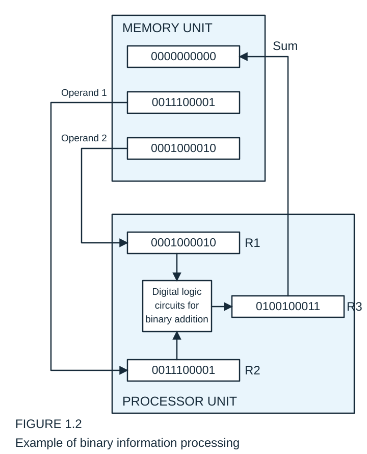
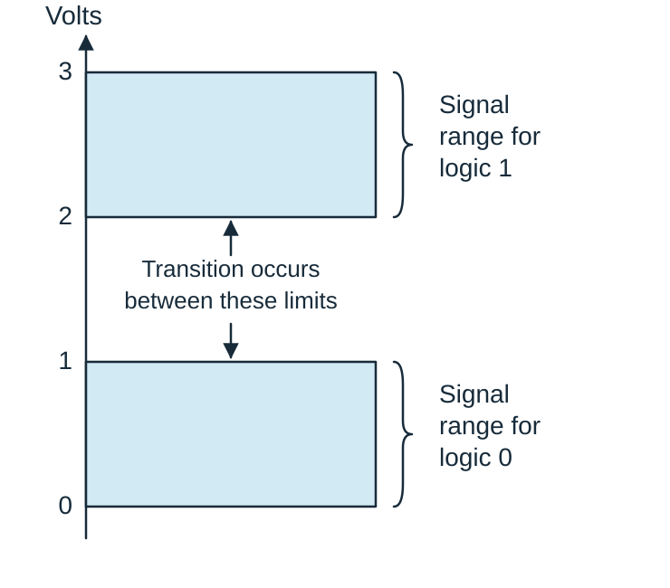

@quiz id="digital-systems-ch1-textbook" revision="2" subject="數位系統導論" tags="binary-numbers,number-systems,base-conversion,complements,signed-binary,bcd,parity,binary-logic,register-transfer" estimatedMinutes="170" current="true"
# 【課本題目】數位系統導論 - Chapter 1

依據 Chapter 1 投影片中的 Example、具體 worked examples 與 Practice Exercise 整理，涵蓋進位制、數制轉換、補數、帶符號二進位、BCD、同位元、暫存器加法與二進位邏輯。請寫出必要的計算過程；可使用文字輸入或手寫作答。

:::question id="q01" type="calculation" points="4" tags="positional-notation,decimal"
### Example

Expand $7,329$ as a decimal number.
:::drawing
width=1200
height=900
:::answer
$7,329=7\times10^3+3\times10^2+2\times10^1+9\times10^0$.
:::solution
$7,329=7\times10^3+3\times10^2+2\times10^1+9\times10^0$.
:::rubric
- 4 | $7\times10^3+3\times10^2+2\times10^1+9\times10^0$.
:::end

:::question id="q02" type="calculation" points="8" tags="base-r,positional-notation,conversion"
### Example

Convert to decimal:

(a) $(11010.11)_2$

(b) $(4021.2)_5$

(c) $(127.4)_8$

(d) $(B65F)_{16}$
:::drawing
width=1200
height=900
:::answer
(a) $(26.75)_{10}$

(b) $(511.4)_{10}$

(c) $(87.5)_{10}$

(d) $(46,687)_{10}$
:::solution
(a) $(11010.11)_2=1\times2^4+1\times2^3+0\times2^2+1\times2^1+0\times2^0+1\times2^{-1}+1\times2^{-2}=(26.75)_{10}$.

(b) $(4021.2)_5=4\times5^3+0\times5^2+2\times5^1+1\times5^0+2\times5^{-1}=(511.4)_{10}$.

(c) $(127.4)_8=1\times8^2+2\times8^1+7\times8^0+4\times8^{-1}=(87.5)_{10}$.

(d) $(B65F)_{16}=11\times16^3+6\times16^2+5\times16^1+15\times16^0=(46,687)_{10}$.
:::rubric
- 2 | (a) 26.75.
- 2 | (b) 511.4.
- 2 | (c) 87.5.
- 2 | (d) 46,687.
:::end

:::question id="q03" type="calculation" points="3" tags="binary,decimal,conversion"
### Example

Convert $(110101)_2$ to decimal.
:::drawing
width=1200
height=900
:::answer
$(110101)_2=(53)_{10}$.
:::solution
$(110101)_2=32+16+4+1=(53)_{10}$.
:::rubric
- 3 | $(53)_{10}$.
:::end

:::question id="q04" type="calculation" points="3" tags="binary,decimal,powers-of-two"
### Practice Exercise 1.1

What is the decimal value of $1\times2^4+0\times2^3+1\times2^2+0\times2^1+1\times2^0$?
:::drawing
width=1200
height=900
:::answer
21
:::solution
21
:::rubric
- 3 | 21.
:::end

:::question id="q40" type="calculation" points="6" tags="binary,addition,subtraction,multiplication"
### Binary Arithmetic

Perform the binary arithmetic operations:

(a) $101101+100111$

(b) $101101-100111$

(c) $1011\times101$
:::drawing
width=1200
height=900
:::answer
(a) $1010100$

(b) $000110$

(c) $110111$
:::solution
(a) $101101+100111=1010100$

(b) $101101-100111=000110$

(c)
$$
\begin{array}{r}
1011\\
\times\ 101\\\hline
1011\\
0000\phantom{0}\\
1011\phantom{00}\\\hline
110111
\end{array}
$$
:::rubric
- 2 | (a) 1010100.
- 2 | (b) 000110.
- 2 | (c) 110111.
:::end

:::question id="q05" type="calculation" points="4" tags="decimal,binary,base-conversion"
### Example 1.1

Convert decimal 41 to binary.
:::drawing
width=1200
height=900
:::answer
$(41)_{10}=(101001)_2$.
:::solution
$$
\begin{array}{r|r}
\text{Integer}&\text{Remainder}\\\hline
41&\\
20&1\\
10&0\\
5&0\\
2&1\\
1&0\\
0&1
\end{array}
$$

$101001=\text{answer}$
:::rubric
- 4 | $(101001)_2$.
:::end

:::question id="q06" type="calculation" points="4" tags="decimal,octal,base-conversion"
### Example 1.2

Convert decimal 153 to octal.
:::drawing
width=1200
height=900
:::answer
$(153)_{10}=(231)_8$.
:::solution
$$
\begin{array}{r|r}
\text{Integer}&\text{Remainder}\\\hline
153&\\
19&1\\
2&3\\
0&2
\end{array}
$$

$=(231)_8$
:::rubric
- 4 | $(231)_8$.
:::end

:::question id="q07" type="calculation" points="4" tags="decimal-fraction,binary,base-conversion"
### Example 1.3

Convert $(0.6875)_{10}$ to binary.
:::drawing
width=1200
height=900
:::answer
$(0.6875)_{10}=(0.1011)_2$.
:::solution
$$
\begin{array}{rcl}
0.6875\times2&=&1+0.3750\\
0.3750\times2&=&0+0.7500\\
0.7500\times2&=&1+0.5000\\
0.5000\times2&=&1+0.0000
\end{array}
$$

$(0.6875)_{10}=(0.1011)_2$
:::rubric
- 4 | $(0.1011)_2$.
:::end

:::question id="q08" type="calculation" points="4" tags="decimal-fraction,octal,base-conversion"
### Example 1.4

Convert $(0.513)_{10}$ to octal.
:::drawing
width=1200
height=900
:::answer
$(0.513)_{10}=(0.406517\ldots)_8$
:::solution
$$
\begin{aligned}
0.513\times8&=4.104\\
0.104\times8&=0.832\\
0.832\times8&=6.656\\
0.656\times8&=5.248\\
0.248\times8&=1.984\\
0.984\times8&=7.872
\end{aligned}
$$

$(0.513)_{10}=(0.406517\ldots)_8$
:::rubric
- 3 | Fractional digits 406517.
- 1 | Continuation after the sixth digit.
:::end

:::question id="q09" type="calculation" points="4" tags="decimal-fraction,octal,base-conversion"
### Practice Exercise 1.2

Convert $(117.23)_{10}$ to octal.
:::drawing
width=1200
height=900
:::answer
$(117.23)_{10}=(165.1656\ldots)_8$
:::solution
$(117.23)_{10}=(165.1656\ldots)_8$
:::rubric
- 2 | Integer digits 165.
- 1 | Fractional digits 1656.
- 1 | Continuation after the fourth fractional digit.
:::end

:::question id="q41" type="calculation" points="8" tags="binary,octal,hexadecimal,base-conversion"
### Octal and Hexadecimal Numbers

Convert:

(a) $(10\ 110\ 001\ 101\ 011.111\ 100\ 000\ 110)_2$ to octal.

(b) $(10\ 1100\ 0110\ 1011.1111\ 0010)_2$ to hexadecimal.

(c) $(673.124)_8$ to binary.

(d) $(306.D)_{16}$ to binary.
:::drawing
width=1200
height=900
:::answer
(a) $(26153.7406)_8$

(b) $(2C6B.F2)_{16}$

(c) $(110\ 111\ 011.001\ 010\ 100)_2$

(d) $(0011\ 0000\ 0110.1101)_2$
:::solution
(a) $(26153.7406)_8$

(b) $(2C6B.F2)_{16}$

(c) $(110\ 111\ 011.001\ 010\ 100)_2$

(d) $(0011\ 0000\ 0110.1101)_2$
:::rubric
- 2 | (a) 26153.7406 in base 8.
- 2 | (b) 2C6B.F2 in base 16.
- 2 | (c) 110 111 011.001 010 100 in base 2.
- 2 | (d) 0011 0000 0110.1101 in base 2.
:::end

:::question id="q10" type="calculation" points="4" tags="diminished-radix-complement,nines-complement"
### Example

Find the 9's complement of (a) 546700 and (b) 012398.
:::drawing
width=1200
height=900
:::answer
(a) 453299

(b) 987601
:::solution
The 9's complement of 546700 is $999999-546700=453299$.

The 9's complement of 012398 is $999999-012398=987601$.
:::rubric
- 2 | (a) 453299.
- 2 | (b) 987601.
:::end

:::question id="q11" type="calculation" points="4" tags="ones-complement,binary"
### Example

Find the 1's complement of (a) 1011000 and (b) 0101101.
:::drawing
width=1200
height=900
:::answer
(a) 0100111

(b) 1010010
:::solution
The 1's complement of 1011000 is 0100111.

The 1's complement of 0101101 is 1010010.
:::rubric
- 2 | (a) 0100111.
- 2 | (b) 1010010.
:::end

:::question id="q12" type="calculation" points="3" tags="decimal,binary,base-conversion"
### Practice Exercise 1.3

Find the binary representation of $135_{10}$.
:::drawing
width=1200
height=900
:::answer
$135_{10}=1000\ 0111_2$
:::solution
$135_{10}=1000\ 0111_2$
:::rubric
- 3 | 10000111 in base 2.
:::end

:::question id="q13" type="calculation" points="3" tags="decimal,octal,base-conversion"
### Practice Exercise 1.4

Find the octal representation of $(135)_{10}$.
:::drawing
width=1200
height=900
:::answer
$135_{10}=207_8$
:::solution
$135_{10}=207_8$
:::rubric
- 3 | 207 in base 8.
:::end

:::question id="q14" type="calculation" points="8" tags="radix-complement,tens-complement,twos-complement"
### Example: Base-10

Find the 10's complement of (a) 012398 and (b) 246700, and the 2's complement of (c) 1101100 and (d) 0110111.
:::drawing
width=1200
height=900
:::answer
(a) 987602

(b) 753300

(c) 0010100

(d) 1001001
:::solution
The 10's complement of 012398 is 987602.

The 10's complement of 246700 is 753300.

The 2's complement of 1101100 is 0010100.

The 2's complement of 0110111 is 1001001.
:::rubric
- 2 | (a) 987602.
- 2 | (b) 753300.
- 2 | (c) 0010100.
- 2 | (d) 1001001.
:::end

:::question id="q15" type="calculation" points="4" tags="nines-complement,tens-complement"
### Practice Exercise 1.5

Find (a) the diminished radix (9's) complement and (b) the radix (10's) complement of $135_{10}$.
:::drawing
width=1200
height=900
:::answer
(a) 9's complement: $864_{10}$

(b) 10's complement: $865_{10}$
:::solution
(a) 9's complement: $864_{10}$

(b) 10's complement: $865_{10}$
:::rubric
- 2 | (a) 864.
- 2 | (b) 865.
:::end

:::question id="q16" type="calculation" points="6" tags="tens-complement,subtraction"
### Example 1.5

Using 10's complement, subtract $72532-3250$.
:::drawing
width=1200
height=900
:::answer
69282
:::solution
$$
\begin{aligned}
M&=72532\\
\text{10's complement of }N&=96750\\
\text{Sum}&=169282\\
\text{Discard end carry }10^5&=-100000\\
\text{Answer}&=69282
\end{aligned}
$$
:::rubric
- 2 | 10's complement of N: 96750.
- 2 | Sum: 169282.
- 2 | Answer: 69282.
:::end

:::question id="q17" type="calculation" points="6" tags="tens-complement,subtraction"
### Example 1.6

Using 10's complement, subtract $3250-72532$.
:::drawing
width=1200
height=900
:::answer
−69282
:::solution
$$
\begin{aligned}
M&=03250\\
\text{10's complement of }N&=27468\\
\text{Sum}&=30718
\end{aligned}
$$

There is no end carry.

Therefore, the answer is $-(\text{10's complement of }30718)=-69282$.
:::rubric
- 2 | 10's complement of N: 27468.
- 2 | Sum: 30718; no end carry.
- 2 | Answer: −69282.
:::end

:::question id="q18" type="calculation" points="8" tags="twos-complement,binary-subtraction"
### Example 1.7

Given the two binary numbers $X=1010100$ and $Y=1000011$, perform the subtraction (a) $X-Y$ and (b) $Y-X$ by using 2's complement.
:::drawing
width=1200
height=900
:::answer
(a) $X-Y=0010001$

(b) $Y-X=-0010001$
:::solution
(a)
$$
\begin{aligned}
X&=1010100\\
\text{2's complement of }Y&=0111101\\
\text{Sum}&=10010001\\
\text{Discard end carry }2^7&=-10000000\\
X-Y&=0010001
\end{aligned}
$$

(b)
$$
\begin{aligned}
Y&=1000011\\
\text{2's complement of }X&=0101100\\
\text{Sum}&=1101111
\end{aligned}
$$

There is no end carry. Therefore, the answer is $Y-X=-(\text{2's complement of }1101111)=-0010001$.
:::rubric
- 4 | (a) 0010001.
- 4 | (b) −0010001.
:::end

:::question id="q19" type="calculation" points="8" tags="ones-complement,binary-subtraction"
### Example 1.8

Repeat Example 1.7, but this time using 1's complement.
:::drawing
width=1200
height=900
:::answer
(a) $X-Y=0010001$

(b) $Y-X=-0010001$
:::solution
(a)
$$
\begin{aligned}
X-Y&=1010100-1000011\\
X&=1010100\\
\text{1's complement of }Y&=0111100\\
\text{Sum}&=10010000\\
\text{End-around carry}&=1\\
X-Y&=0010001
\end{aligned}
$$

(b)
$$
\begin{aligned}
Y-X&=1000011-1010100\\
Y&=1000011\\
\text{1's complement of }X&=0101011\\
\text{Sum}&=1101110
\end{aligned}
$$

There is no end carry. Therefore, the answer is $Y-X=-(\text{1's complement of }1101110)=-0010001$.
:::rubric
- 4 | (a) 0010001.
- 4 | (b) −0010001.
:::end

:::question id="q20" type="calculation" points="8" tags="twos-complement,binary-subtraction"
### Practice Exercise 1.6

Give $X=(1101010)_2$ and $Y=(0101011)_2$, (a) find $X-Y$ and (b) find $Y-X$ using 2's complements.
:::drawing
width=1200
height=900
:::answer
(a) $X-Y=(0111111)_2=63_{10}$

(b) $Y-X=-(0111111)_2=-63_{10}$
:::solution
(a)
$$
\begin{aligned}
X&=(1101010)_2=106_{10},\quad Y=(0101011)_2=43_{10}\\
X-Y&=106_{10}-43_{10}=63_{10}\\
\text{2's complement of }Y&=1010101_2\\
X-Y&=(1101010)_2+(1010101)_2\\
&=(0111111)_2=63_{10}
\end{aligned}
$$

(b)
$$
\begin{aligned}
Y-X&=43_{10}-106_{10}=-63_{10}\\
\text{2's complement of }X&=(0010110)_2\\
Y-X&=(0101011)_2+(0010110)_2=(1000001)_2\\
Y-X&=-(\text{2's complement of }1000001)_2\\
&=-(0111111)_2=-63_{10}
\end{aligned}
$$

No carry
:::rubric
- 4 | (a) 0111111, +63.
- 4 | (b) −0111111, −63.
:::end

:::question id="q21" type="calculation" points="8" tags="ones-complement,binary-subtraction"
### Practice Exercise 1.7

Repeat Practice Exercise 1.6 using 1's complements.
:::drawing
width=1200
height=900
:::answer
(a) $X-Y=(0111111)_2=63_{10}$

(b) $Y-X=-(0111111)_2=-63_{10}$
:::solution
(a)
$$
\begin{aligned}
X&=(1101010)_2=106_{10},\quad Y=(0101011)_2=43_{10}\\
X-Y&=106_{10}-43_{10}=63_{10}\\
\text{1's complement of }Y&=1010100_2\\
X-Y&=(1101010)_2+(1010100)_2=(10111110)_2\\
X-Y&=0111110_2+0000001_2=0111111_2=63_{10}
\end{aligned}
$$

End-around carry

(b)
$$
\begin{aligned}
X&=(1101010)_2=106_{10},\quad Y=(0101011)_2=43_{10}\\
Y-X&=43_{10}-106_{10}=-63_{10}\\
\text{1's complement of }X&=(0010101)_2\\
Y-X&=(0101011)_2+(0010101)_2=(1000000)_2
\end{aligned}
$$

No end-around carry

$Y-X=-(\text{1's complement of }1000000)_2=-(0111111)_2=-63_{10}$
:::rubric
- 4 | (a) 0111111, +63.
- 4 | (b) −0111111, −63.
:::end

:::question id="q22" type="calculation" points="6" tags="signed-binary,signed-magnitude,ones-complement,twos-complement"
### Example

Find the decimal number represented by the signed-magnitude representation 10001001 and its signed-1's-complement and signed-2's-complement representations.
:::drawing
width=1200
height=900
:::answer
$-9$

Signed-magnitude representation: 10001001

Signed-1's-complement representation: 11110110

Signed-2's-complement representation: 11110111
:::solution
Signed-magnitude representation: 10001001

Signed-1's-complement representation: 11110110

Signed-2's-complement representation: 11110111
:::rubric
- 2 | Decimal value: −9.
- 1 | Signed magnitude: 10001001.
- 1 | Signed 1's complement: 11110110.
- 2 | Signed 2's complement: 11110111.
:::end

:::question id="q23" type="calculation" points="2" tags="unsigned-binary,decimal"
### Practice Exercise 1.19

What unsigned binary number is represented by the string of bits 11001?
:::drawing
width=1200
height=900
:::answer
$25_{10}$
:::solution
$25_{10}$
:::rubric
- 2 | 25 in decimal.
:::end

:::question id="q24" type="calculation" points="2" tags="signed-binary,sign-bit"
### Practice Exercise 1.8

Which bit of signed binary number represents the sign?
:::answer
The leftmost bit
:::solution
The leftmost bit
:::rubric
- 2 | The leftmost bit.
:::end

:::question id="q25" type="calculation" points="3" tags="signed-magnitude"
### Practice Exercise 1.10

What decimal number does the signed-magnitude binary number N = 10011 represent?
:::drawing
width=1200
height=900
:::answer
$N=-3_{10}$
:::solution
$N=-3_{10}$
:::rubric
- 3 | N = −3.
:::end

:::question id="q26" type="calculation" points="3" tags="signed-magnitude"
### Practice Exercise 1.11

Convert the signed-magnitude binary number N = 01100 to a negative value having the same magnitude.
:::drawing
width=1200
height=900
:::answer
N = 11100
:::solution
N = 11100
:::rubric
- 3 | N = 11100.
:::end

:::question id="q27" type="calculation" points="6" tags="signed-binary,signed-magnitude,ones-complement,twos-complement"
### Practice Exercise 1.12

Represent $-5$ three ways with 8 bits: (a) signed-magnitude (b) signed 1's complement, and (c) signed 2's complement.
:::drawing
width=1200
height=900
:::answer
(a) 10000101

(b) 11111010

(c) 11111011
:::solution
(a) 10000101

(b) 11111010

(c) 11111011
:::rubric
- 2 | (a) 10000101.
- 2 | (b) 11111010.
- 2 | (c) 11111011.
:::end

:::question id="q28" type="calculation" points="4" tags="twos-complement,negation"
### Practice Exercise 1.13

In the signed-2's-complement system, negate the number $7_{10}$, represented with 8 bits.
:::drawing
width=1200
height=900
:::answer
$1111\ 1001_2$
:::solution
$N=0000\ 0111_2$

1's comp $=1111\ 1000_2$

2's comp $=1111\ 1001_2$
:::rubric
- 1 | +7: 00000111.
- 3 | −7: 11111001.
:::end

:::question id="q29" type="calculation" points="8" tags="signed-binary,twos-complement,addition"
### Example

Perform the addition with 8 bits in signed-2's-complement form:

(a) $(+6)+(+13)$

(b) $(-6)+(+13)$

(c) $(+6)+(-13)$

(d) $(-6)+(-13)$
:::drawing
width=1200
height=900
:::answer
(a) $+19:\ 00010011$

(b) $+7:\ 00000111$

(c) $-7:\ 11111001$

(d) $-19:\ 11101101$
:::solution
(a) $00000110+00001101=00010011\quad(+19)$

(b) $11111010+00001101=00000111\quad(+7)$

(c) $00000110+11110011=11111001\quad(-7)$

(d) $11111010+11110011=11101101\quad(-19)$
:::rubric
- 2 | (a) +19, 00010011.
- 2 | (b) +7, 00000111.
- 2 | (c) −7, 11111001.
- 2 | (d) −19, 11101101.
:::end

:::question id="q30" type="calculation" points="4" tags="signed-binary,twos-complement,subtraction"
### Example

Perform $(-6)-(-13)$ in 2's-complement form.
:::drawing
width=1200
height=900
:::answer
$00000111\quad(+7)$
:::solution
$$
\begin{aligned}
(-6)-(-13)&\\
(11111010-11110011)&\\
(11111010+00001101)&\\
00000111&\quad(+7)
\end{aligned}
$$
:::rubric
- 2 | 11111010 + 00001101.
- 2 | 00000111, +7.
:::end

:::question id="q31" type="calculation" points="8" tags="signed-binary,twos-complement,addition"
### Practice Exercise 1.14

Perform the addition with 8 bits in signed-2's-complement form:

(a) $+4+(+11)$

(b) $-4+(+11)$

(c) $+4+(-11)$

(d) $-4+(-11)$
:::drawing
width=1200
height=900
:::answer
(a) $+15:\ 0000\ 1111$

(b) $+7:\ 0000\ 0111$

(c) $-7:\ 1111\ 1001$

(d) $-15:\ 1111\ 0001$
:::solution
(a) $0000\ 0100+0000\ 1011=0000\ 1111\quad(+15)$

(b) $1111\ 1100+0000\ 1011=0000\ 0111\quad(+7)$

(c) $0000\ 0100+1111\ 0101=1111\ 1001\quad(-7)$

(d) $1111\ 1100+1111\ 0101=1111\ 0001\quad(-15)$
:::rubric
- 2 | (a) +15, 00001111.
- 2 | (b) +7, 00000111.
- 2 | (c) −7, 11111001.
- 2 | (d) −15, 11110001.
:::end

:::question id="q32" type="calculation" points="3" tags="bcd,decimal-code"
### Practice Exercise 1.15

Find the BCD representation of $84_{10}$.
:::drawing
width=1200
height=900
:::answer
$84_{10}=1000\ 0100_{\mathrm{BCD}}$
:::solution
$84_{10}=1000\ 0100_{\mathrm{BCD}}$
:::rubric
- 3 | 1000 0100 in BCD.
:::end

:::question id="q33" type="calculation" points="4" tags="bcd,binary,decimal-code"
### Example

Consider decimal 185 and its corresponding value in BCD and binary:
:::drawing
width=1200
height=900
:::answer
$(185)_{10}=(0001\ 1000\ 0101)_{\mathrm{BCD}}=(10111001)_2$
:::solution
$(185)_{10}=(0001\ 1000\ 0101)_{\mathrm{BCD}}=(10111001)_2$
:::rubric
- 2 | BCD: 0001 1000 0101.
- 2 | Binary: 10111001.
:::end

:::question id="q34" type="calculation" points="6" tags="bcd,addition"
### BCD Addition

Find the BCD sum of (a) $4+5$, (b) $4+8$, and (c) $8+9$.
:::drawing
width=1200
height=900
:::answer
(a) $1001$

(b) $0001\ 0010$

(c) $0001\ 0111$
:::solution
(a) $0100+0101=1001$

(b) $0100+1000=1100$; $1100+0110=0001\ 0010$

(c) $1000+1001=10001$; $10001+0110=0001\ 0111$
:::rubric
- 2 | (a) 1001.
- 2 | (b) 0001 0010.
- 2 | (c) 0001 0111.
:::end

:::question id="q35" type="calculation" points="3" tags="bcd,addition"
### Practice Exercise 1.16

Find the BCD sum of 4 + 6.
:::drawing
width=1200
height=900
:::answer
$0001\ 0000$
:::solution
$0001\ 0000$
:::rubric
- 3 | 0001 0000 in BCD.
:::end

:::question id="q36" type="calculation" points="6" tags="bcd,addition"
### Example

Find the sum of 184 + 576 in BCD.
:::drawing
width=1200
height=900
:::answer
$0111\ 0110\ 0000\quad(760)$
:::solution
$$
\begin{array}{rccc}
&1&1&\\
\mathrm{BCD}&0001&1000&0100\\
+&0101&0111&0110\\\hline
\text{Binary sum}&0111&10000&1010\\
\text{Add 6}&&0110&0110\\\hline
\text{BCD sum}&0111&0110&0000
\end{array}
$$

$760$
:::rubric
- 2 | Hundreds: 0111.
- 2 | Tens: 0110.
- 2 | Units: 0000; sum 760.
:::end

:::question id="q37" type="calculation" points="6" tags="parity,ascii,error-detection"
### Example

Consider the following two characters and their even and odd parity:

ASCII A = 1000001

ASCII T = 1010100
:::drawing
width=1200
height=900
:::answer
With even parity:

ASCII A: 01000001

ASCII T: 11010100

With odd parity:

ASCII A: 11000001

ASCII T: 01010100
:::solution
With even parity:

ASCII A: 01000001

ASCII T: 11010100

With odd parity:

ASCII A: 11000001

ASCII T: 01010100
:::rubric
- 3 | Even parity: A 01000001; T 11010100.
- 3 | Odd parity: A 11000001; T 01010100.
:::end

:::question id="q38" type="calculation" points="2" tags="parity,error-detection"
### Practice Exercise 1.18

What is the even parity bit of A = 0101100?
:::drawing
width=1200
height=900
:::answer
1
:::solution
1
:::rubric
- 2 | 1.
:::end

:::question id="q42" type="calculation" points="4" tags="binary,addition,register-transfer"
### Example of binary information processing

Find the binary addition result in R3, its decimal value, and the contents of Sum after the transfer.

:::drawing
width=1200
height=900
:::answer
R3 = 0100100011 = $291_{10}$

Sum = 0100100011
:::solution

:::rubric
- 2 | R1 = 0001000010 and R2 = 0011100001; R3 = 0100100011, decimal 291.
- 2 | R3 output transferred to memory Sum: 0100100011.
:::end

:::question id="q39" type="calculation" points="4" tags="binary-logic,signal-levels"
### Example of binary signals

Identify the signal ranges for logic 0 and logic 1 and the transition limits.

:::answer
Signal range for logic 0: 0–1 Volts

Signal range for logic 1: 2–3 Volts

Transition occurs between these limits: 1–2 Volts
:::solution

:::rubric
- 2 | Logic 0: 0–1 V; logic 1: 2–3 V.
- 2 | Transition: between 1 V and 2 V.
:::end

