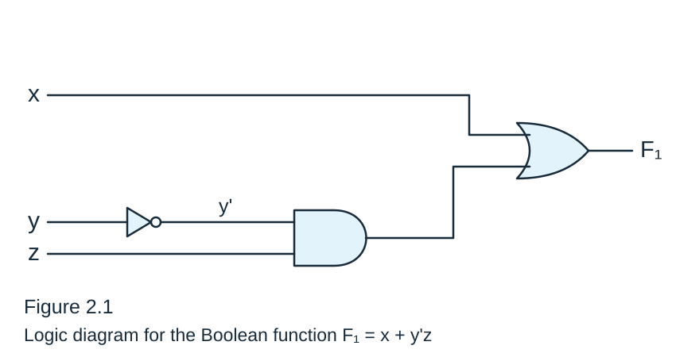
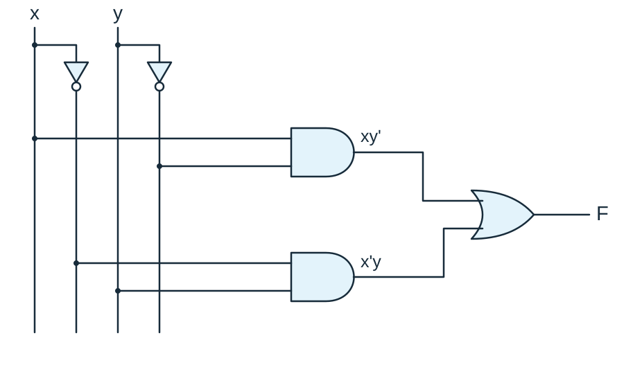
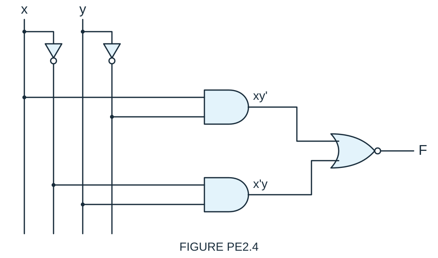
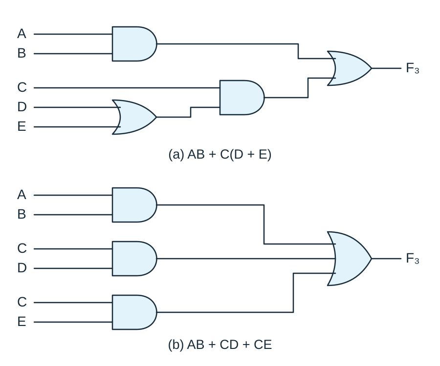
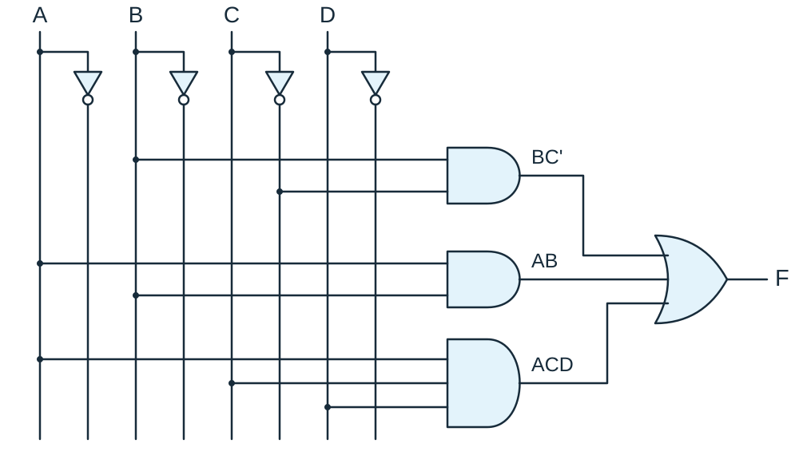
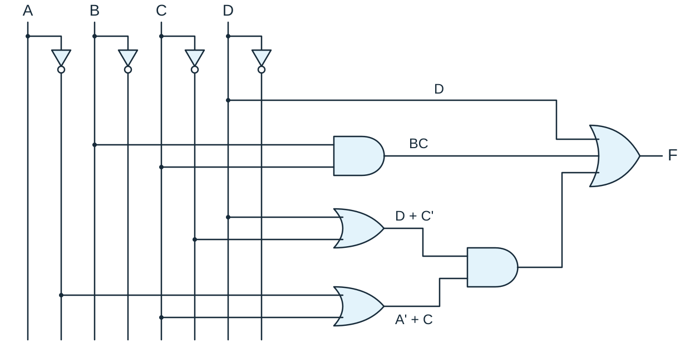
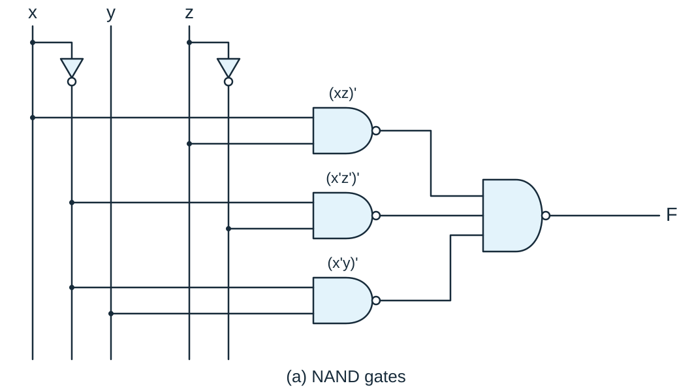
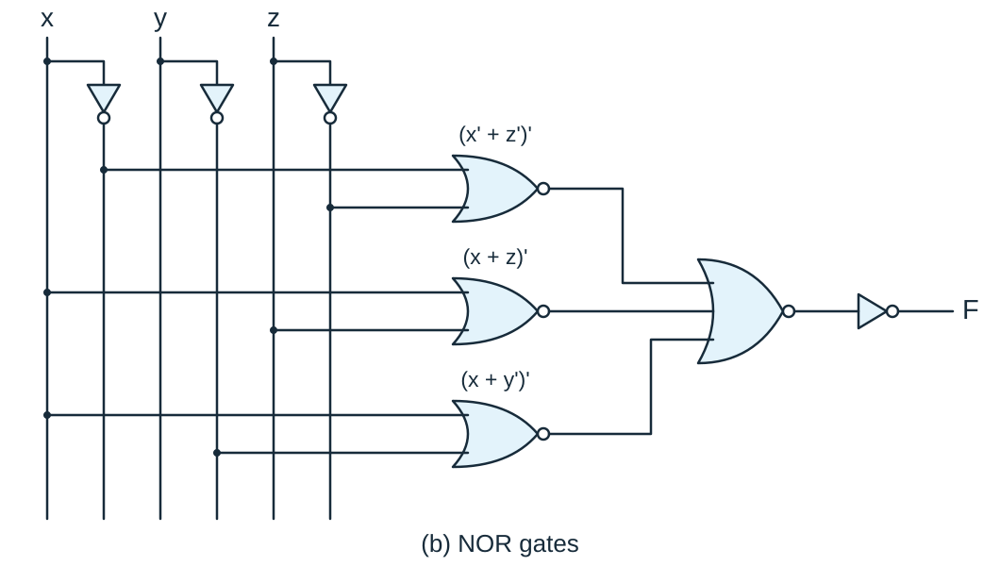

@quiz id="digital-systems-ch2-textbook" revision="2" subject="數位系統導論" tags="boolean-algebra,postulates,boolean-theorems,demorgan,boolean-functions,truth-tables,logic-diagrams,canonical-forms,minterms,maxterms,two-level-implementation,multi-level-implementation,nand-nor" estimatedMinutes="115" current="true"
# 【課本題目】數位系統導論 - Chapter 2

依據 Chapter 2（Boolean Algebra and Logic Gates）投影片中的 Example、具體 worked examples 與 Practice Exercise 整理，涵蓋代數結構公設、布林代數定理與 DeMorgan 定理、布林函數與真值表、邏輯圖、函數補數、minterm／maxterm 標準式、兩級與多級實作，以及 NAND／NOR 實作。請寫出必要的推導過程；可使用文字輸入或手寫作答。

:::question id="q01" type="calculation" points="4" tags="postulates,identity-element,inverse"
### Example

Find the identity element with respect to + on the set of integers I and on the set of natural numbers N, and the inverse of an element a in I.
:::drawing
width=1200
height=900
:::answer
The element 0 is an identity element with respect to the binary operator + on the set of integers I, since $x+0=0+x=x$ for any $x\in I$.

The set of natural numbers, N, has no identity element, since 0 is excluded from the set.

In the set of integers, I, and the operator +, with $e=0$, the inverse of an element $a$ is $(-a)$, since $a+(-a)=0$.
:::solution
The element 0 is an identity element with respect to the binary operator + on the set of integers I, since $x+0=0+x=x$ for any $x\in I$.

The set of natural numbers, N, has no identity element, since 0 is excluded from the set.

In the set of integers, I, and the operator +, with $e=0$, the inverse of an element $a$ is $(-a)$, since $a+(-a)=0$.
:::rubric
- 1 | Integers: identity 0.
- 1 | Natural numbers N: no identity.
- 2 | Inverse of a: −a.
:::end

:::question id="q02" type="calculation" points="2" tags="operator-precedence,boolean-expressions"
### examples

Find the operator precedence in (a) $xy'+z$ and (b) $(xy+z)'$.
:::drawing
width=1200
height=900
:::answer
(a) NOT, AND, OR

(b) Parentheses: AND, OR; NOT
:::solution
(a) NOT, AND, OR

(b) Parentheses: AND, OR; NOT
:::rubric
- 1 | (a) NOT → AND → OR.
- 1 | (b) Parentheses: AND → OR; then NOT.
:::end

:::question id="q03" type="calculation" points="4" tags="boolean-simplification,boolean-theorems"
### Practice Exercise 2.1

Using the basic theorems and postulates of Boolean algebra, simplfy the following Boolean expression: $F=x'y'z+xyz+x'yz+xy'z$.
:::drawing
width=1200
height=900
:::answer
$F=z$
:::solution
$F=z$
:::rubric
- 4 | $F=z$.
:::end

:::question id="q04" type="calculation" points="3" tags="truth-tables,boolean-functions"
### Practice Exercise 2.2

Develop a truth table for the Boolean expression $F=x'y'z$.
:::drawing
width=1200
height=900
:::answer
$$
\begin{array}{ccc|c}
x & y & z & F\\\hline
0&0&0&0\\
0&0&1&1\\
0&1&0&0\\
0&1&1&0\\
1&0&0&0\\
1&0&1&0\\
1&1&0&0\\
1&1&1&0
\end{array}
$$
:::solution
$$
\begin{array}{ccc|c}
x & y & z & F\\\hline
0&0&0&0\\
0&0&1&1\\
0&1&0&0\\
0&1&1&0\\
1&0&0&0\\
1&0&1&0\\
1&1&0&0\\
1&1&1&0
\end{array}
$$
:::rubric
- 1 | All eight x, y, z rows.
- 2 | F: 0, 1, 0, 0, 0, 0, 0, 0.
:::end

:::question id="q05" type="calculation" points="8" tags="boolean-functions,truth-tables,logic-diagrams,boolean-simplification"
### Examples

For $F_1=x+y'z$ and $F_2=x'y'z+x'yz+xy'$:

(a) Develop the truth table for $F_1$ and $F_2$.

(b) Minimize $F_2$.

(c) Draw the logic diagram for $F_1$.
:::drawing
width=1200
height=900
:::answer
(a)

$$
\begin{array}{ccc|cc}
x & y & z & F_1 & F_2\\\hline
0&0&0&0&0\\
0&0&1&1&1\\
0&1&0&0&0\\
0&1&1&0&1\\
1&0&0&1&1\\
1&0&1&1&1\\
1&1&0&1&0\\
1&1&1&1&0
\end{array}
$$

(b) $F_2=xy'+x'z$

(c)

:::solution
(a)

$$
\begin{array}{ccc|cc}
x & y & z & F_1 & F_2\\\hline
0&0&0&0&0\\
0&0&1&1&1\\
0&1&0&0&0\\
0&1&1&0&1\\
1&0&0&1&1\\
1&0&1&1&1\\
1&1&0&1&0\\
1&1&1&1&0
\end{array}
$$

(b) $F_2=xy'+x'z$

(c)

:::rubric
- 2 | (a) F1: 0, 1, 0, 0, 1, 1, 1, 1.
- 2 | (a) F2: 0, 1, 0, 1, 1, 1, 0, 0.
- 2 | (b) $F_2=xy'+x'z$.
- 2 | (c) NOT(y) → y'; AND(y', z) → y'z; OR(x, y'z) → F1.
:::end

:::question id="q06" type="calculation" points="10" tags="boolean-simplification,literals,duality"
### EXAMPLE 2.1

Simplify the following Boolean functions to a minimum number of literals.

1. $x(x'+y)$
2. $x+x'y$
3. $(x+y)(x+y')$
4. $xy+x'z+yz$
5. $(x+y)(x'+z)(y+z)$
:::drawing
width=1200
height=900
:::answer
1. $xy$
2. $x+y$
3. $x$
4. $xy+x'z$
5. $(x+y)(x'+z)$
:::solution
1. $x(x'+y)=xx'+xy=0+xy=xy$.

2. $x+x'y=(x+x')(x+y)=1(x+y)=x+y$.

3. $(x+y)(x+y')=x+xy+xy'+yy'=x(1+y+y')=x$.

4.
$$
\begin{aligned}
xy+x'z+yz&=xy+x'z+yz(x+x')\\
&=xy+x'z+xyz+x'yz\\
&=xy(1+z)+x'z(1+y)\\
&=xy+x'z.
\end{aligned}
$$

5. $(x+y)(x'+z)(y+z)=(x+y)(x'+z)$, by duality from function 4.
:::rubric
- 2 | 1. $xy$.
- 2 | 2. $x+y$.
- 2 | 3. $x$.
- 2 | 4. $xy+x'z$.
- 2 | 5. $(x+y)(x'+z)$.
:::end

:::question id="q07" type="calculation" points="6" tags="complement,demorgan"
### EXAMPLE 2.2

Find the complement of the functions $F_1=x'yz'+x'y'z$ and $F_2=x(y'z'+yz)$.
:::drawing
width=1200
height=900
:::answer
$F_1'=(x+y'+z)(x+y+z')$

$F_2'=x'+yz'+y'z$
:::solution
$$
\begin{aligned}
F_1'&=(x'yz'+x'y'z)'\\
&=(x'yz')'(x'y'z)'\\
&=(x+y'+z)(x+y+z')
\end{aligned}
$$

$$
\begin{aligned}
F_2'&=[x(y'z'+yz)]'\\
&=x'+(y'z'+yz)'\\
&=x'+(y'z')'(yz)'\\
&=x'+(y+z)(y'+z')\\
&=x'+yz'+y'z
\end{aligned}
$$
:::rubric
- 3 | $F_1'=(x+y'+z)(x+y+z')$.
- 2 | $F_2'=x'+(y+z)(y'+z')$.
- 1 | $F_2'=x'+yz'+y'z$.
:::end

:::question id="q08" type="calculation" points="6" tags="complement,duality"
### EXAMPLE 2.3

Find the complement of the functions $F_1$ and $F_2$ of Example 2.2 by taking their duals and complementing each literal.
:::drawing
width=1200
height=900
:::answer
1. The dual of $F_1$ is $(x'+y+z')(x'+y'+z)$.

Complement each literal: $(x+y'+z)(x+y+z')=F_1'$.

2. The dual of $F_2$ is $x+(y'+z')(y+z)$.

Complement each literal: $x'+(y+z)(y'+z')=F_2'$.
:::solution
1. $F_1=x'yz'+x'y'z$.

The dual of $F_1$ is $(x'+y+z')(x'+y'+z)$.

Complement each literal: $(x+y'+z)(x+y+z')=F_1'$.

2. $F_2=x(y'z'+yz)$.

The dual of $F_2$ is $x+(y'+z')(y+z)$.

Complement each literal: $x'+(y+z)(y'+z')=F_2'$.
:::rubric
- 1 | Dual of $F_1$: $(x'+y+z')(x'+y'+z)$.
- 2 | $F_1'=(x+y'+z)(x+y+z')$.
- 1 | Dual of $F_2$: $x+(y'+z')(y+z)$.
- 2 | $F_2'=x'+(y+z)(y'+z')$.
:::end

:::question id="q09" type="calculation" points="4" tags="logic-diagrams,xor"
### Practice Exercise 2.3

Draw a logic diagram of the Boolean function $F=x'y+xy'$.
:::drawing
width=1200
height=900
:::answer

:::solution

:::rubric
- 1 | NOT(x) → x'; NOT(y) → y'.
- 2 | Upper AND(x, y') → xy'; lower AND(x', y) → x'y.
- 1 | OR(xy', x'y) → F.
:::end

:::question id="q10" type="calculation" points="4" tags="logic-diagrams,demorgan,nor"
### Practice Exercise 2.4

What Boolean expression is implemented by the following logic diagram?

:::drawing
width=1200
height=900
:::answer
$F=(x'y+xy')'=xy+x'y'$
:::solution
$$
\begin{aligned}
F&=(x'y+xy')'\\
&=(x'y)'(xy')'\\
&=(x+y')(x'+y)\\
&=xx'+xy+y'x'+yy'\\
&=xy+x'y'
\end{aligned}
$$
:::rubric
- 2 | $F=(x'y+xy')'$.
- 2 | $F=xy+x'y'$.
:::end

:::question id="q11" type="calculation" points="3" tags="truth-tables,logic-diagrams"
### Practice Exercise 2.5

What truth table is implemented by the logic diagram in Fig.PE2.4?

:::drawing
width=1200
height=900
:::answer
$$
\begin{array}{cc|c}
x & y & F\\\hline
0&0&1\\
0&1&0\\
1&0&0\\
1&1&1
\end{array}
$$
:::solution
$$
\begin{array}{cc|c}
x & y & F\\\hline
0&0&1\\
0&1&0\\
1&0&0\\
1&1&1
\end{array}
$$
:::rubric
- 1 | All four x, y rows.
- 2 | F: 1, 0, 0, 1.
:::end

:::question id="q12" type="calculation" points="4" tags="complement,demorgan"
### Practice Exercise 2.6

Find the complement of the Boolean function $F=A'BC'+A'B'C$.
:::drawing
width=1200
height=900
:::answer
$F'=A+BC+B'C'$
:::solution
$F'=A+BC+B'C'$
:::rubric
- 4 | $F'=A+BC+B'C'$.
:::end

:::question id="q13" type="calculation" points="6" tags="minterms,maxterms,canonical-forms"
### Canonical and Standard Forms

Express $f_1$ and $f_2$ as a sum of minterms and a product of maxterms, and find $f_1'$.

$$
\begin{array}{ccc|cc}
x & y & z & f_1 & f_2\\\hline
0&0&0&0&0\\
0&0&1&1&0\\
0&1&0&0&0\\
0&1&1&0&1\\
1&0&0&1&0\\
1&0&1&0&1\\
1&1&0&0&1\\
1&1&1&1&1
\end{array}
$$
:::drawing
width=1200
height=900
:::answer
(a) $f_1=x'y'z+xy'z'+xyz=m_1+m_4+m_7$

$f_2=x'yz+xy'z+xyz'+xyz=m_3+m_5+m_6+m_7$

(b) $f_1'=m_0+m_2+m_3+m_5+m_6$

(c) $f_1=M_0M_2M_3M_5M_6$

$f_2=M_0M_1M_2M_4$
:::solution
$f_1=x'y'z+xy'z'+xyz=m_1+m_4+m_7$

$f_2=x'yz+xy'z+xyz'+xyz=m_3+m_5+m_6+m_7$

$f_1'=m_0+m_2+m_3+m_5+m_6=x'y'z'+x'yz'+x'yz+xy'z+xyz'$

$$
\begin{aligned}
f_1&=(f_1')'\\
&=(x+y+z)(x+y'+z)(x+y'+z')\\
&\quad(x'+y+z')(x'+y'+z)\\
&=M_0M_2M_3M_5M_6
\end{aligned}
$$

$f_2=(x+y+z)(x+y+z')(x+y'+z)(x'+y+z)=M_0M_1M_2M_4$
:::rubric
- 2 | (a) f1: m1 + m4 + m7; f2: m3 + m5 + m6 + m7.
- 1 | (b) f1': m0 + m2 + m3 + m5 + m6.
- 3 | (c) f1: M0 M2 M3 M5 M6; f2: M0 M1 M2 M4.
:::end

:::question id="q14" type="calculation" points="5" tags="minterms,sum-of-minterms,canonical-forms"
### EXAMPLE 2.4

Express the Boolean function $F=A+B'C$ as a sum of minterms.
:::drawing
width=1200
height=900
:::answer
$F=A'B'C+AB'C'+AB'C+ABC'+ABC$

$F(A,B,C)=\Sigma(1,4,5,6,7)$
:::solution
$$
\begin{aligned}
F&=A+B'C\\
&=A(B+B')+B'C\\
&=AB+AB'+B'C\\
&=AB(C+C')+AB'(C+C')+(A+A')B'C\\
&=ABC+ABC'+AB'C+AB'C'+A'B'C
\end{aligned}
$$

$F=A'B'C+AB'C'+AB'C+ABC'+ABC$

$=m_1+m_4+m_5+m_6+m_7$

$F(A,B,C)=\Sigma(1,4,5,6,7)$
:::rubric
- 3 | $A'B'C+AB'C'+AB'C+ABC'+ABC$.
- 2 | $\Sigma(1,4,5,6,7)$.
:::end

:::question id="q15" type="calculation" points="5" tags="maxterms,product-of-maxterms,canonical-forms"
### EXAMPLE 2.5

Express the Boolean function $F=xy+x'z$ as a product of maxterms.
:::drawing
width=1200
height=900
:::answer
$F=(x+y+z)(x+y'+z)(x'+y+z)(x'+y+z')$

$=M_0M_2M_4M_5$

$F(x,y,z)=\Pi(0,2,4,5)$
:::solution
$$
\begin{aligned}
F&=xy+x'z\\
&=(xy+x')(xy+z)\\
&=(x+x')(y+x')(x+z)(y+z)\\
&=(x'+y)(x+z)(y+z)
\end{aligned}
$$

$x'+y=x'+y+zz'=(x'+y+z)(x'+y+z')$

$F=(x+y+z)(x+y'+z)(x'+y+z)(x'+y+z')$

$=M_0M_2M_4M_5$

$F(x,y,z)=\Pi(0,2,4,5)$
:::rubric
- 3 | $(x+y+z)(x+y'+z)(x'+y+z)(x'+y+z')$.
- 2 | $\Pi(0,2,4,5)$.
:::end

:::question id="q16" type="calculation" points="3" tags="canonical-forms,conversion"
### Conversion between Canonical Forms

Find $F'$ as a sum of minterms and express $F(A,B,C)=\Sigma(1,4,5,6,7)$ as a product of maxterms.
:::drawing
width=1200
height=900
:::answer
$F'(A,B,C)=\Sigma(0,2,3)=m_0+m_2+m_3$

$F=M_0M_2M_3=\Pi(0,2,3)$
:::solution
$F'(A,B,C)=\Sigma(0,2,3)=m_0+m_2+m_3$

By DeMorgan's theorem

$F=(m_0+m_2+m_3)'=m_0'\cdot m_2'\cdot m_3'=M_0M_2M_3=\Pi(0,2,3)$
:::rubric
- 1 | $F'=\Sigma(0,2,3)$.
- 2 | $F=\Pi(0,2,3)$.
:::end

:::question id="q17" type="calculation" points="4" tags="minterms,maxterms,truth-tables"
### Example

Develop the truth table for $F=xy+x'z$, express $F$ as a sum of minterms and a product of maxterms, and find $F'$.
:::drawing
width=1200
height=900
:::answer
$$
\begin{array}{ccc|c}
x & y & z & F\\\hline
0&0&0&0\\
0&0&1&1\\
0&1&0&0\\
0&1&1&1\\
1&0&0&0\\
1&0&1&0\\
1&1&0&1\\
1&1&1&1
\end{array}
$$

$F(x,y,z)=\Sigma(1,3,6,7)$

$F(x,y,z)=\Pi(0,2,4,5)$

$F'=\Sigma(0,2,4,5)$
:::solution
$$
\begin{array}{ccc|c}
x & y & z & F\\\hline
0&0&0&0\\
0&0&1&1\\
0&1&0&0\\
0&1&1&1\\
1&0&0&0\\
1&0&1&0\\
1&1&0&1\\
1&1&1&1
\end{array}
$$

$F(x,y,z)=\Sigma(1,3,6,7)$

$F(x,y,z)=\Pi(0,2,4,5)$

$F'=\Sigma(0,2,4,5)$
:::rubric
- 1 | F: 0, 1, 0, 1, 0, 0, 1, 1.
- 1 | $F=\Sigma(1,3,6,7)$.
- 2 | $F=\Pi(0,2,4,5)$; $F'=\Sigma(0,2,4,5)$.
:::end

:::question id="q18" type="calculation" points="4" tags="maxterms,product-of-maxterms,conversion"
### Practice Exercise 2.7

Find a product of maxterms expression for $F(x,y,z)=\Sigma(1,2,3,5,7)$.
:::drawing
width=1200
height=900
:::answer
$F'=\Sigma(0,4,6)$

$F=(x+y+z)(x'+y+z)(x'+y'+z)$
:::solution
$F'=\Sigma(0,4,6)$

$F=(x+y+z)(x'+y+z)(x'+y'+z)$
:::rubric
- 1 | $F'=\Sigma(0,4,6)$.
- 3 | $F=(x+y+z)(x'+y+z)(x'+y'+z)$.
:::end

:::question id="q19" type="calculation" points="4" tags="minterms,sum-of-minterms,conversion"
### Practice Exercise 2.8

Find a sum of minterms expression for $F(x,y,z)=\Pi(1,3,4,6)$.
:::drawing
width=1200
height=900
:::answer
$F(x,y,z)=\Sigma(0,2,5,7)=x'y'z'+x'yz'+xy'z+xyz$
:::solution
$F(x,y,z)=\Sigma(0,2,5,7)=x'y'z'+x'yz'+xy'z+xyz$
:::rubric
- 2 | $\Sigma(0,2,5,7)$.
- 2 | $x'y'z'+x'yz'+xy'z+xyz$.
:::end

:::question id="q20" type="calculation" points="4" tags="minterms,maxterms,truth-tables"
### Practice Exercise 2.9

Identify the minterms and maxterms of the truth table for $F$ shown below.

$$
\begin{array}{ccc|c}
x & y & z & F\\\hline
0&0&0&0\\
0&0&1&1\\
0&1&0&0\\
0&1&1&1\\
1&0&0&1\\
1&0&1&0\\
1&1&0&1\\
1&1&1&0
\end{array}
$$
:::drawing
width=1200
height=900
:::answer
$F=\Sigma(1,3,4,6)=\Pi(0,2,5,7)$
:::solution
$F=\Sigma(1,3,4,6)=\Pi(0,2,5,7)$
:::rubric
- 2 | $\Sigma(1,3,4,6)$.
- 2 | $\Pi(0,2,5,7)$.
:::end

:::question id="q26" type="calculation" points="4" tags="standard-forms,sum-of-products,multi-level-implementation,two-level-implementation"
### Standard Forms

Express $F_3=AB+C(D+E)$ as a sum of products and draw its three- and two-level implementation.
:::drawing
width=1200
height=900
:::answer
$F_3=AB+CD+CE$

:::solution
$F_3=AB+C(D+E)=AB+CD+CE$

:::rubric
- 2 | $F_3=AB+CD+CE$.
- 1 | Three levels: AND(A,B) → AB; OR(D,E) → D+E; AND(C,D+E) → C(D+E); OR(AB,C(D+E)) → F3.
- 1 | Two levels: AND(A,B) → AB; AND(C,D) → CD; AND(C,E) → CE; OR(AB,CD,CE) → F3.
:::end

:::question id="q21" type="calculation" points="4" tags="minterms,sum-of-minterms,four-variables"
### Practice Exercise 2.10

Express the Boolean function $F=A+B'C+AD$ as a sum of minterms.
:::drawing
width=1200
height=900
:::answer
$F=\Sigma(2,3,8,9,\allowbreak 10,11,\allowbreak 12,13,\allowbreak 14,15)$
:::solution
$F=\Sigma(2,3,8,9,\allowbreak 10,11,\allowbreak 12,13,\allowbreak 14,15)$
:::rubric
- 2 | Minterms 8, 9, 10, 11, 12, 13, 14, 15.
- 1 | Minterms 2, 3.
- 1 | $\Sigma(2,3,8,9,\allowbreak 10,11,\allowbreak 12,13,\allowbreak 14,15)$.
:::end

:::question id="q22" type="calculation" points="4" tags="maxterms,product-of-maxterms"
### Practice Exercise 2.11

Express the Boolean function $F=x'y+xz$ as a product of maxterms.
:::drawing
width=1200
height=900
:::answer
$F=(x+y+z)(x+y+z')(x'+y+z)(x'+y'+z)$
:::solution
$F=(x+y+z)(x+y+z')(x'+y+z)(x'+y'+z)$
:::rubric
- 4 | $(x+y+z)(x+y+z')(x'+y+z)(x'+y'+z)$.
:::end

:::question id="q23" type="calculation" points="4" tags="two-level-implementation,logic-diagrams,sum-of-products"
### Practice Exercise 2.12

Draw a two-level logic diagram to implement the Boolean function $F=BC'+AB+ACD$.
:::drawing
width=1200
height=900
:::answer

:::solution

:::rubric
- 1 | NOT(C) → C'.
- 2 | AND(B,C') → BC'; AND(A,B) → AB; AND(A,C,D) → ACD.
- 1 | OR(BC',AB,ACD) → F.
:::end

:::question id="q24" type="calculation" points="5" tags="logic-diagrams,multi-level-implementation"
### Practice Exercise 2.13

Draw the logic diagram corresponding to the following Boolean expression without simplifying it: $F=D+BC+(D+C')(A'+C)$.
:::drawing
width=1200
height=900
:::answer

:::solution

:::rubric
- 1 | NOT(A) → A'; NOT(C) → C'; AND(B,C) → BC.
- 2 | OR(D,C') → D+C'; OR(A',C) → A'+C; AND(D+C',A'+C) → (D+C')(A'+C).
- 2 | OR(D,BC,(D+C')(A'+C)) → F.
:::end

:::question id="q25" type="calculation" points="8" tags="nand,nor,universal-gates,demorgan"
### Practice Exercise 2.14

Implement the Boolean function $F=xz+x'z'+x'y$ with (a) NAND and inverter gates, and (b) NOR and inverter gates.
:::drawing
width=1200
height=900
:::answer
(a) NAND gates

$F=[(xz)'(x'z')'(x'y)']'$

(b) NOR gates

$F'=(x'+z')(x+z)(x+y')$

$F=(x'+z')'+(x+z)'+(x+y')'$

:::solution
(a) NAND gates

$F=xz+x'z'+x'y$

$F'=(xz)'(x'z')'(x'y)'$

$F=[(xz)'(x'z')'(x'y)']'$

(b) NOR gates

$F'=(x'+z')(x+z)(x+y')$

$F=(x'+z')'+(x+z)'+(x+y')'$

:::rubric
- 2 | NAND form: $F=[(xz)'(x'z')'(x'y)']'$.
- 2 | NOT(x) → x'; NOT(z) → z'; NAND(x,z), NAND(x',z'), NAND(x',y) → 3-input NAND → F.
- 2 | NOR form: $F'=(x'+z')(x+z)(x+y')$; $F=(x'+z')'+(x+z)'+(x+y')'$.
- 2 | NOT(x), NOT(y), NOT(z) supply x', y', z'; NOR(x',z'), NOR(x,z), NOR(x,y') → 3-input NOR → NOT → F.
:::end
