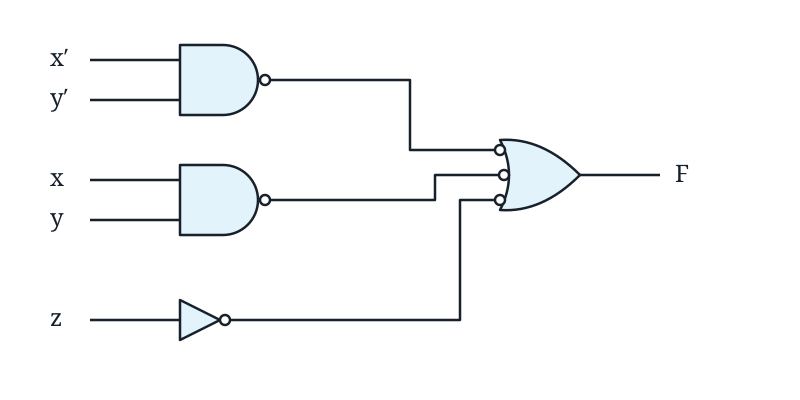
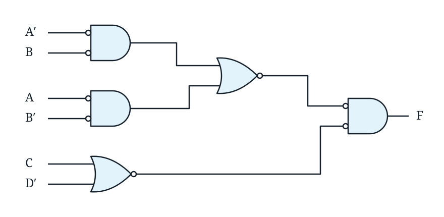
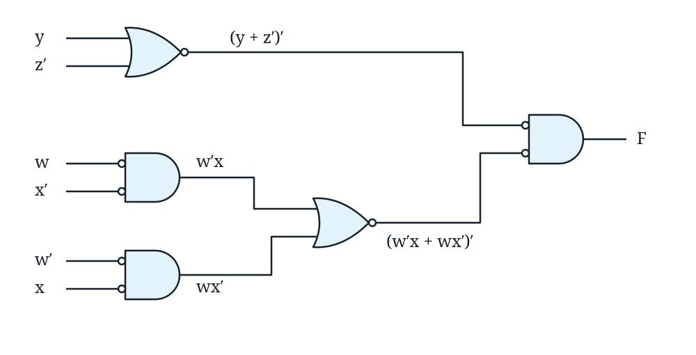

@quiz id="digital-systems-ch3-textbook" revision="1" subject="數位系統導論" tags="karnaugh-map,gate-level-minimization,minterms,maxterms,prime-implicants,product-of-sums,dont-care,nand,nor,aoi,oai" estimatedMinutes="135" current="true"
# 【課本題目】數位系統導論 - Chapter 3

依據 Chapter 3（Gate-Level Minimization）投影片中的 Example 與 Practice Exercise 整理，涵蓋 Karnaugh map、prime implicants、SOP／POS 化簡、don't-care conditions，以及 NAND／NOR 實作。題目維持投影片原文；請寫出必要推導，可使用文字輸入或手寫作答。

:::question id="q01" type="calculation" points="4" tags="karnaugh-map,three-variable,sop"
### Example 3-1

$F(x,y,z)=\Sigma(2,3,4,5)$

:::drawing
width=1200
height=900
:::answer
正確解答為 $F=x'y+xy'$。
:::solution
將 $m_2,m_3$ 配成一組，兩格中 $x=0$、$y=1$ 固定，因此得到 $x'y$。再將 $m_4,m_5$ 配成一組，兩格中 $x=1$、$y=0$ 固定，因此得到 $xy'$。兩組相加後為 $F=x'y+xy'$。
:::rubric
- 2 | $m_2,m_3\rightarrow x'y$。
- 2 | $m_4,m_5\rightarrow xy'$，得到 $F=x'y+xy'$。
:::end

:::question id="q02" type="calculation" points="4" tags="karnaugh-map,three-variable,sop"
### Example 3-2

$F(x,y,z)=\Sigma(3,4,6,7)$

:::drawing
width=1200
height=900
:::answer
正確解答為 $F=yz+xz'$。
:::solution
將 $m_3,m_7$ 配成一組，固定 $y=1,z=1$，得到 $yz$。再利用 K-map 左右邊界相鄰的特性，將 $m_4,m_6$ 配成一組；固定 $x=1,z=0$，得到 $xz'$。因此 $F=yz+xz'$。
:::rubric
- 2 | $m_3,m_7\rightarrow yz$。
- 2 | $m_4,m_6\rightarrow xz'$，得到 $F=yz+xz'$。
:::end

:::question id="q03" type="calculation" points="4" tags="karnaugh-map,three-variable,sop"
### Example 3-3

$F(x,y,z)=\Sigma(0,2,4,5,6)$

:::drawing
width=1200
height=900
:::answer
正確解答為 $F=z'+xy'$。
:::solution
將 $m_0,m_2,m_4,m_6$ 組成四格，四格皆有 $z=0$，因此化為 $z'$。剩餘的 $m_5$ 可與 $m_4$ 配成一組，固定 $x=1,y=0$，得到 $xy'$。所以 $F=z'+xy'$。
:::rubric
- 2 | $m_0,m_2,m_4,m_6\rightarrow z'$。
- 2 | $m_4,m_5\rightarrow xy'$，得到 $F=z'+xy'$。
:::end

:::question id="q04" type="calculation" points="8" tags="karnaugh-map,minterms,sop"
### Example 3-4

$F=A'C+A'B+AB'C+BC$

express it in sum of minterms

find the minimal sum of products expression

:::drawing
width=1200
height=900
:::answer
以 minterm 表示為 $F(A,B,C)=\Sigma(1,2,3,5,7)$；最小 sum-of-products 為 $F=C+A'B$。
:::solution
先依序列出各乘積項涵蓋的 minterm，可得函數為 $1$ 的輸入編號是 $1,2,3,5,7$，所以 $F(A,B,C)=\Sigma(1,2,3,5,7)$。在 K-map 中，$m_1,m_3,m_5,m_7$ 可組成四格，固定 $C=1$，得到 $C$；$m_2,m_3$ 可組成兩格，固定 $A=0,B=1$，得到 $A'B$。因此最小 SOP 為 $F=C+A'B$。
:::rubric
- 3 | $F(A,B,C)=\Sigma(1,2,3,5,7)$。
- 3 | 四格化簡得到 $C$。
- 2 | 兩格化簡得到 $A'B$，故 $F=C+A'B$。
:::end

:::question id="q05" type="calculation" points="4" tags="practice-exercise,karnaugh-map,three-variable"
### Practice Exercise 3.1

Simplify the Boolean function $F(x,y,z)=\Sigma(0,1,6,7)$.

:::drawing
width=1200
height=900
:::answer
正確解答為 $F(x,y,z)=xy+x'y'$。
:::solution
$m_0,m_1$ 可配成一組，固定 $x=0,y=0$，得到 $x'y'$；$m_6,m_7$ 可配成另一組，固定 $x=1,y=1$，得到 $xy$。因此 $F=xy+x'y'$。
:::rubric
- 2 | $m_0,m_1\rightarrow x'y'$。
- 2 | $m_6,m_7\rightarrow xy$，得到 $F=xy+x'y'$。
:::end

:::question id="q06" type="calculation" points="4" tags="practice-exercise,karnaugh-map,three-variable"
### Practice Exercise 3.2

Simplify the Boolean function $F(x,y,z)=\Sigma(0,1,2,5)$.

:::drawing
width=1200
height=900
:::answer
正確解答為 $F(x,y,z)=x'z'+y'z$。
:::solution
利用左右邊界相鄰，$m_0,m_2$ 可配成一組，固定 $x=0,z=0$，得到 $x'z'$。另外 $m_1,m_5$ 配成一組，固定 $y=0,z=1$，得到 $y'z$。因此 $F=x'z'+y'z$。
:::rubric
- 2 | $m_0,m_2\rightarrow x'z'$。
- 2 | $m_1,m_5\rightarrow y'z$，得到 $F=x'z'+y'z$。
:::end

:::question id="q07" type="calculation" points="4" tags="practice-exercise,karnaugh-map,three-variable"
### Practice Exercise 3.3

Simplify the Boolean function $F(x,y,z)=\Sigma(0,2,3,4,6)$.

:::drawing
width=1200
height=900
:::answer
正確解答為 $F(x,y,z)=z'+x'y$。
:::solution
$m_0,m_2,m_4,m_6$ 組成四格，固定 $z=0$，得到 $z'$。$m_2,m_3$ 再配成一組，固定 $x=0,y=1$，得到 $x'y$。因此 $F=z'+x'y$。
:::rubric
- 2 | $m_0,m_2,m_4,m_6\rightarrow z'$。
- 2 | $m_2,m_3\rightarrow x'y$，得到 $F=z'+x'y$。
:::end

:::question id="q08" type="calculation" points="8" tags="practice-exercise,minterms,karnaugh-map,sop"
### Practice Exercise 3.4

For the Boolean function $F(x,y,z)=xy'z+x'y+x'z+yz$, (a) express this function as a sum of minterms, and (b) find the minimal sum-of-products expression.

:::drawing
width=1200
height=900
:::answer
(a) $F(x,y,z)=m_1+m_2+m_3+m_5+m_7=\Sigma(1,2,3,5,7)$。

(b) 最小 sum-of-products 為 $F=z+x'y$。
:::solution
將原式展開成 minterm，可得函數為 $1$ 的編號為 $1,2,3,5,7$。在 K-map 中，$m_1,m_3,m_5,m_7$ 組成四格，固定 $z=1$，得到 $z$；$m_2,m_3$ 組成兩格，固定 $x=0,y=1$，得到 $x'y$。因此 $F=z+x'y$。
:::rubric
- 4 | (a) $\Sigma(1,2,3,5,7)$。
- 4 | (b) $F=z+x'y$。
:::end

:::question id="q09" type="calculation" points="6" tags="karnaugh-map,four-variable,sop"
### Example 3-5

$F(w,x,y,z)=\Sigma(0,1,2,4,5,6,8,9,12,13,14)$

:::drawing
width=1200
height=900
:::answer
正確解答為 $F=y'+w'z'+xz'$。
:::solution
先將 $m_0,m_1,m_4,m_5,m_8,m_9,m_{12},m_{13}$ 組成八格，固定 $y=0$，得到 $y'$。再以 $m_0,m_2,m_4,m_6$ 組成四格，固定 $w=0,z=0$，得到 $w'z'$；以 $m_4,m_6,m_{12},m_{14}$ 組成四格，固定 $x=1,z=0$，得到 $xz'$。因此 $F=y'+w'z'+xz'$。
:::rubric
- 2 | 八格得到 $y'$。
- 2 | 四格得到 $w'z'$。
- 2 | 四格得到 $xz'$，故 $F=y'+w'z'+xz'$。
:::end

:::question id="q10" type="calculation" points="8" tags="karnaugh-map,four-variable,sop"
### Example 3-6

Simplify the Boolean function

$F=A'B'C'+B'CD'+A'BCD'+AB'C'$

:::drawing
width=1200
height=900
:::answer
正確解答為 $F=B'D'+B'C'+A'CD'$。
:::solution
將各乘積項對應到四變數 K-map。$B'D'$ 可由四格合併得到，$B'C'$ 也可由另一組四格得到；剩餘需要覆蓋的格子以 $A'CD'$ 表示。三個 implicant 合併後，得到最小化結果 $F=B'D'+B'C'+A'CD'$。
:::rubric
- 3 | $B'D'$。
- 3 | $B'C'$。
- 2 | $A'CD'$，故 $F=B'D'+B'C'+A'CD'$。
:::end

:::question id="q11" type="calculation" points="5" tags="practice-exercise,karnaugh-map,four-variable"
### Practice Exercise 3.5

Simplify the Boolean function $F(w,x,y,z)=\Sigma(0,1,3,8,9,10,11,12,13,14,15)$.

:::drawing
width=1200
height=900
:::answer
正確解答為 $F(w,x,y,z)=x'y'+x'z+w$。
:::solution
$m_8$ 到 $m_{15}$ 可組成八格，得到 $w$。$m_0,m_1,m_8,m_9$ 組成四格，固定 $x=0,y=0$，得到 $x'y'$；$m_1,m_3,m_9,m_{11}$ 組成四格，固定 $x=0,z=1$，得到 $x'z$。因此 $F=x'y'+x'z+w$。
:::rubric
- 2 | $w$。
- 1 | $x'y'$。
- 2 | $x'z$，故 $F=x'y'+x'z+w$。
:::end

:::question id="q12" type="calculation" points="5" tags="practice-exercise,karnaugh-map,four-variable"
### Practice Exercise 3.6

Simplify the Boolean function $F(w,x,y,z)=\Sigma(0,2,4,6,8,10,11)$.

:::drawing
width=1200
height=900
:::answer
正確解答為 $F(w,x,y,z)=w'z'+x'z'+wx'y$。
:::solution
$m_0,m_2,m_4,m_6$ 組成四格，得到 $w'z'$；$m_0,m_2,m_8,m_{10}$ 組成四格，得到 $x'z'$；$m_{10},m_{11}$ 組成兩格，得到 $wx'y$。所以 $F=w'z'+x'z'+wx'y$。
:::rubric
- 2 | $w'z'$。
- 1 | $x'z'$。
- 2 | $wx'y$，故 $F=w'z'+x'z'+wx'y$。
:::end

:::question id="q13" type="calculation" points="6" tags="practice-exercise,prime-implicants,karnaugh-map"
### Practice Exercise 3.7

Find the prime implicants of the Boolean function

$F(w,x,y,z)=\Sigma(0,2,4,5,6,7,8,10,13,14,15)$

:::drawing
width=1200
height=900
:::answer
所有 prime implicants 為 $x'z',\ xz,\ xy,\ w'x,\ w'z',\ yz'$。
:::solution
投影片答案誤植：第一項印為 $x'y'$，但它涵蓋原函數為 $0$ 的 $m_1,m_9$，因此不是 implicant；正確應為 $x'z'$，涵蓋 $m_0,m_2,m_8,m_{10}$。逐一枚舉所有可合併且無法再擴大的群組，另外五組為 $xz$（$5,7,13,15$）、$xy$（$6,7,14,15$）、$w'x$（$4,5,6,7$）、$w'z'$（$0,2,4,6$）、$yz'$（$2,6,10,14$）。題目要求所有 prime implicants，六項都必須列出，不能只列最小覆蓋。
:::rubric
- 6 | 完整列出 $x'z', xz, xy, w'x, w'z', yz'$，每項 1 分。
:::end

:::question id="q14" type="calculation" points="8" tags="karnaugh-map,product-of-sums,maxterms"
### Example 3-7

$F=\Sigma(0,1,2,5,8,9,10)$

:::drawing
width=1200
height=900
:::answer
由 0 的群組可得 $F'=AB+CD+BD'$，因此

$F=(A'+B')(C'+D')(B'+D)$。

同一函數的最小 SOP 可寫成 $F=B'D'+B'C'+A'C'D$。

:::solution
若以 K-map 的 0 進行分組，可先得到補數 $F'=AB+CD+BD'$。套用 DeMorgan 定理：

$F=(F')'=(AB+CD+BD')'=(A'+B')(C'+D')(B'+D)$。

若改由 1 進行分組，則可得到等價的 SOP：$B'D'+B'C'+A'C'D$。兩種形式皆實作同一個 $F$。

:::rubric
- 3 | $F'=AB+CD+BD'$。
- 3 | $F=(A'+B')(C'+D')(B'+D)$。
- 2 | 等價 SOP：$B'D'+B'C'+A'C'D$。
:::end

:::question id="q15" type="calculation" points="10" tags="practice-exercise,karnaugh-map,sop,pos,truth-table"
### Practice Exercise 3.8

Simplify the Boolean function $F(w,x,y,z)=\Sigma(0,2,8,10,12,13,14)$ into

(a) sum-of-products form and (b) product-of-sums form. Derive the truth table of $F$.

:::drawing
width=1200
height=900
:::answer
(a) $F(w,x,y,z)=x'z'+wz'+wxy'$。

(b) $F'(w,x,y,z)=w'x+yz+x'z$，因此 $F(w,x,y,z)=(w+x')(y'+z')(x+z')$。

真值表為：

$$
\begin{array}{c|c}
wxyz & F\\\hline
0000&1\\
0001&0\\
0010&1\\
0011&0\\
0100&0\\
0101&0\\
0110&0\\
0111&0\\
1000&1\\
1001&0\\
1010&1\\
1011&0\\
1100&1\\
1101&1\\
1110&1\\
1111&0
\end{array}
$$
:::solution
SOP 由 1 的群組取得：$x'z'$、$wz'$、$wxy'$，所以 $F=x'z'+wz'+wxy'$。POS 可先對 0 分組得到 $F'=w'x+yz+x'z$，再用 DeMorgan 定理取補數，得到 $F=(w+x')(y'+z')(x+z')$。真值表直接依 $\Sigma(0,2,8,10,12,13,14)$ 填入：這七個 minterm 的 $F=1$，其餘為 $0$。投影片答案誤植：真值表左半部八列的輸入欄都印成 $0000$；上表依二進位順序修正為 $0000$ 至 $0111$，原有輸出值不變。
:::rubric
- 3 | (a) $F=x'z'+wz'+wxy'$。
- 3 | (b) $F=(w+x')(y'+z')(x+z')$。
- 4 | 16 列真值表與 $\Sigma(0,2,8,10,12,13,14)$ 一致。
:::end

:::question id="q16" type="calculation" points="6" tags="dont-care,karnaugh-map,four-variable"
### Example 3-8

$F(w,x,y,z)=\Sigma(1,3,7,11,15)$

$d(w,x,y,z)=\Sigma(0,2,5)$

:::drawing
width=1200
height=900
:::answer
投影片給出的兩個可接受化簡結果為 $F=yz+w'x'$ 或 $F=yz+w'z$。
:::solution
don't-care 格可視需要當作 0 或 1。共同的四格 $m_3,m_7,m_{11},m_{15}$ 化為 $yz$。若將 $m_0,m_2$ 連同 $m_1,m_3$ 使用，可形成 $w'x'$，得到 $F=yz+w'x'$；若改用 $m_1,m_3,m_5,m_7$，則形成 $w'z$，得到 $F=yz+w'z$。兩種化簡都只在 don't-care 輸入上可能不同，因此都符合原函數。
:::rubric
- 3 | 共同群組 $m_3,m_7,m_{11},m_{15}$ 得到 $yz$。
- 3 | 使用 don't-care 得到 $w'x'$ 或 $w'z$，任一完整結果皆可得滿分，且不改變指定輸入的函數值。
:::end

:::question id="q17" type="calculation" points="6" tags="practice-exercise,dont-care,karnaugh-map"
### Practice Exercise 3.9

Simplify the Boolean function $F(w,x,y,z)=\Sigma(4,5,6,7,12)$ with don't care

function $d(w,x,y,z)=\Sigma(0,8,13)$.

:::drawing
width=1200
height=900
:::answer
正確解答為 $F(w,x,y,z)=xy'+xw'$。
:::solution
$m_4,m_5,m_6,m_7$ 可組成四格，固定 $w=0,x=1$，得到 $xw'$。為了覆蓋 $m_{12}$，可使用 don't-care $m_{13}$，把 $m_4,m_5,m_{12},m_{13}$ 組成四格，固定 $x=1,y=0$，得到 $xy'$。因此 $F=xy'+xw'$。
:::rubric
- 3 | $xw'$。
- 3 | 利用 $m_{13}$ 的 don't-care 得到 $xy'$，故 $F=xy'+xw'$。
:::end

:::question id="q18" type="calculation" points="4" tags="nand,two-level-implementation"
### Example:

$F=AB+CD$

:::drawing
width=1200
height=900
:::answer
以兩級 NAND-NAND 實作時，$F=((AB)'(CD)')'=AB+CD$。
:::solution
第一級分別以 NAND 產生 $(AB)'$ 與 $(CD)'$。第二級再以 NAND 對這兩個結果取反相乘積：

$((AB)'(CD)')'=(AB)+(CD)$，

因此輸出仍為 $F=AB+CD$。
:::rubric
- 2 | 第一級產生 $(AB)'$ 與 $(CD)'$。
- 2 | 第二級 NAND 得到 $F=((AB)'(CD)')'=AB+CD$。
:::end

:::question id="q19" type="calculation" points="8" tags="nand,two-level-implementation,karnaugh-map"
### Example 3-9

$F(x,y,z)=\Sigma(1,2,3,4,5,7)$

:::drawing
width=1200
height=900
:::answer
K-map 化簡後為 $F(x,y,z)=xy'+x'y+z$，並可用兩級 NAND-NAND 實作。

:::solution
K-map 中可分別形成 $xy'$、$x'y$ 與 $z$ 三個 implicant，因此 $F=xy'+x'y+z$。NAND-NAND 實作時，第一級產生 $(xy')'$、$(x'y)'$，而單一 literal $z$ 先反相成 $z'$；第二級 NAND 得到

$[(xy')'(x'y)'z']'=xy'+x'y+z$。

:::rubric
- 4 | $F=xy'+x'y+z$。
- 4 | 正確兩級 NAND-NAND 實作。
:::end

:::question id="q20" type="calculation" points="8" tags="practice-exercise,nand,two-level-implementation"
### Practice Exercise 3.10

Implement the Boolean function $F(x,y,z)=\Sigma(0,1,3,5,6,7)$ with NAND

gates, and draw the logic diagram of the implementation.

:::drawing
width=1200
height=900
:::answer
先化簡得 $F(x,y,z)=x'y'+xy+z$，再以 NAND-NAND 結構實作。

:::solution
K-map 化簡得到三項 $x'y'$、$xy$、$z$。第一級用 NAND 產生 $(x'y')'$ 與 $(xy)'$，單一 literal $z$ 先反相成 $z'$；第二級以三輸入 NAND 合併：

$[(x'y')'(xy)'z']'=x'y'+xy+z$。

因此可完全以 NAND gates 完成。

:::rubric
- 4 | $F=x'y'+xy+z$。
- 4 | 邏輯圖與 NAND-NAND 實作等價。
:::end

:::question id="q21" type="calculation" points="6" tags="nor,product-of-sums"
### Example:

$F=(A+B)(C+D)E$

:::drawing
width=1200
height=900
:::answer
可用 NOR 結構實作：

$F=[(A+B)'+(C+D)'+E']'$。

:::solution
先用 NOR 分別得到 $(A+B)'$ 與 $(C+D)'$，並取得 $E'$。最後再用 NOR 對三個反相信號做和後反相：

$[(A+B)'+(C+D)'+E']'=(A+B)(C+D)E$。

這正是 POS 對應的 NOR-NOR 實作。

:::rubric
- 3 | 第一級得到 $(A+B)'$、$(C+D)'$、$E'$。
- 3 | 第二級 NOR 得到 $F=(A+B)(C+D)E$。
:::end

:::question id="q22" type="calculation" points="8" tags="nor,multilevel-implementation"
### Example:

$F=(AB'+A'B)(C+D')$

:::drawing
width=1200
height=900
:::answer
以 NOR gates 可先形成 $(AB'+A'B)'$ 與 $(C+D')'$，再由最後一級的等價 NOR 結構得到

$F=(AB'+A'B)(C+D')$。

:::solution
依來源接線，前兩個 invert-AND（NOR alternate symbol）分別接 $A',B$ 與 $A,B'$，輸出 $(A')'B'=AB'$ 與 $A' (B')'=A'B$；兩者送入 NOR 得到 $(AB'+A'B)'$。另一支路以 NOR 得到 $(C+D')'$。最後 invert-AND 對這兩個訊號各取反再相乘，輸出 $[(AB'+A'B)'+(C+D')']'=(AB'+A'B)(C+D')$。

:::rubric
- 3 | 正確形成 $AB'$ 與 $A'B$。
- 2 | 得到 $(AB'+A'B)'$ 與 $(C+D')'$。
- 3 | 最後輸出等價於原函數。
:::end

:::question id="q23" type="calculation" points="10" tags="practice-exercise,nor,multilevel-implementation"
### Practice Exercise 3.11

Implement the Boolean function $F(W,x,y,z)=(y+z')(wx'+w'x)$ with

NOR gates.

:::drawing
width=1200
height=900
:::answer
依投影片更正後，內部 NOR 輸出應為 $(w'x+wx')'$。完整 NOR 實作可由 $(y+z')'$ 與 $(w'x+wx')'$ 經最後一級等價 NOR／invert-AND 結構得到

$F=(y+z')(wx'+w'x)$。

:::solution
第一支路用 NOR 形成 $(y+z')'$。第二支路依來源以 invert-AND（NOR alternate symbol）分別接 $w,x'$ 與 $w',x$，輸出 $w'x$ 與 $wx'$，再經 NOR 得到 $(w'x+wx')'$。投影片特別註明原書圖中少了加號；正確標示是 $(w'x+wx')'$。最後 invert-AND 輸出 $[(y+z')'+(w'x+wx')']'=(y+z')(wx'+w'x)$。題目函數參數的 $W$ 大寫與式內的 $w$ 小寫均保留來源原文；運算以式內的 $w,x,y,z$ 為準。

:::rubric
- 3 | 形成 $(y+z')'$。
- 3 | 形成更正後的 $(w'x+wx')'$。
- 4 | 最後 NOR 等價結構輸出原函數。
:::end

:::question id="q24" type="calculation" points="8" tags="aoi,oai,complement"
### Example 3-10

$F'=x'y+xy'+z$ $\qquad$ $(F':\ \text{sum of products})$

:::drawing
width=1200
height=900
:::answer
對應的 AOI 表示為 $F=(x'y+xy'+z)'$。

等價地，$F=x'y'z'+xyz'$，因此

$F'=(x+y+z)(x'+y'+z)$，

對應的 OAI 表示為

$F=((x+y+z)(x'+y'+z))'$。
:::solution
由給定的 $F'$ 直接取補數，可得 AOI 形式 $F=(x'y+xy'+z)'$。再將 $F$ 寫成 SOP，可得 $F=x'y'z'+xyz'$。對此 SOP 取補數並用 DeMorgan 定理，可得 $F'=(x+y+z)(x'+y'+z)$；再取補數即得到 OAI 形式 $F=((x+y+z)(x'+y'+z))'$。
:::rubric
- 2 | $F=(x'y+xy'+z)'$。
- 2 | $F=x'y'z'+xyz'$。
- 2 | $F'=(x+y+z)(x'+y'+z)$。
- 2 | $F=((x+y+z)(x'+y'+z))'$。
:::end
