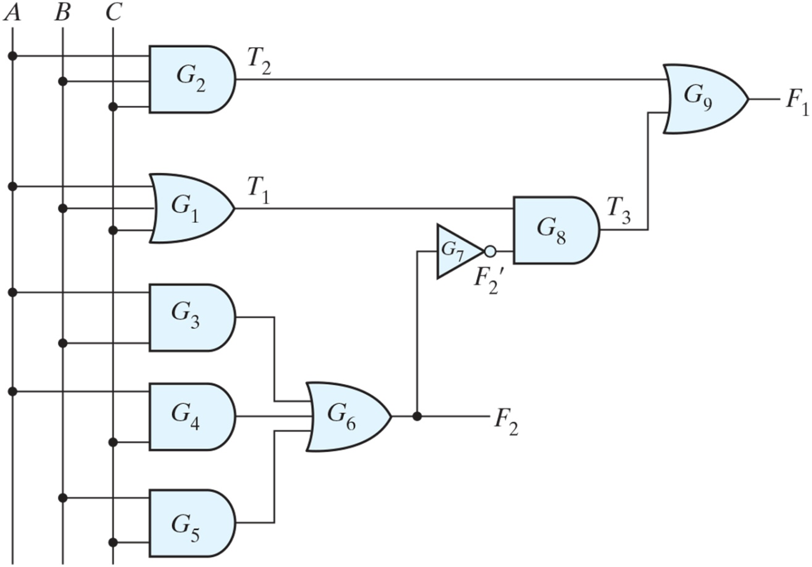
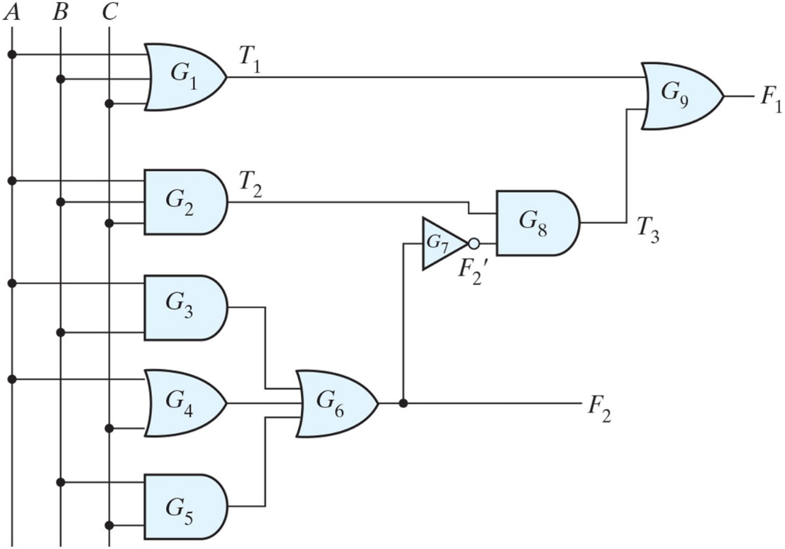
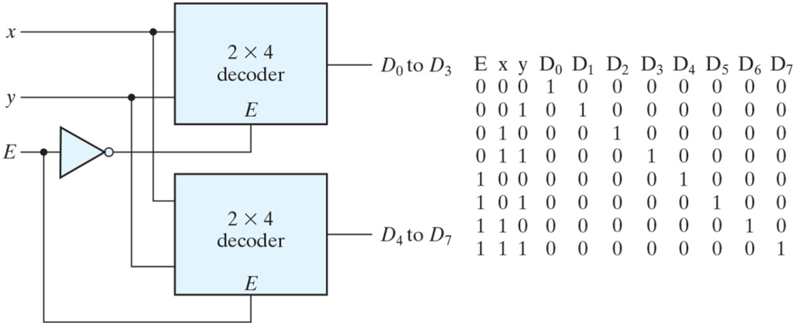
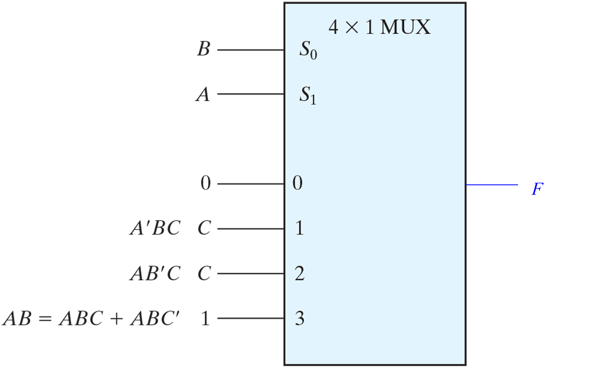
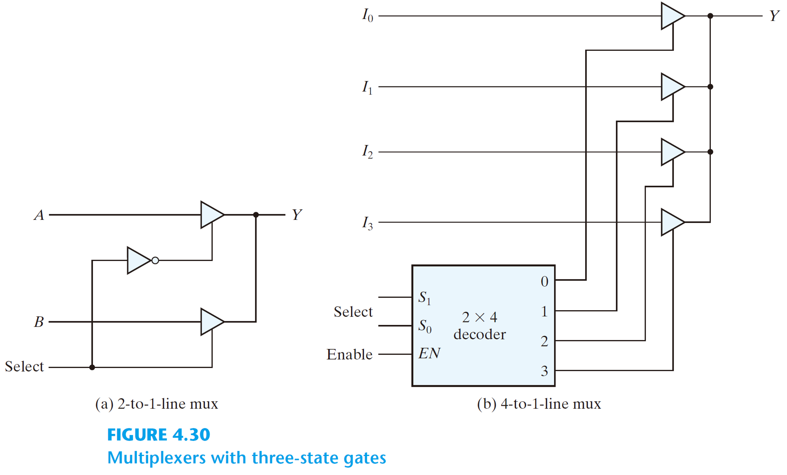

@quiz id="digital-systems-ch4-textbook" revision="1" subject="數位系統導論" tags="combinational-logic,analysis,code-conversion,half-adder,full-adder,ripple-adder,lookahead-adder,subtractor,overflow,binary-multiplier,decoder,multiplexer,three-state-gates" estimatedMinutes="105" current="true"
# 【課本題目】數位系統導論 - Chapter 4

依據 Chapter 4（Combinational Logic）投影片中的 Example 與 Practice Exercise 整理。題目、原始答案文字與公式維持投影片原文；對於投影片只呈現布林代數式、圖形或解題流程而未寫明作答任務的 Example，僅依該例題實際流程補上英文 task instruction。

:::question id="q01" type="calculation" points="10" tags="example,combinational-analysis,full-adder"
### Analysis example

Analyze the logic diagram in Fig. 4.2. Derive the Boolean expressions for $F_1$ and $F_2$, construct the truth table, and identify the circuit function.

:::drawing
width=1200
height=900
:::answer
$F_2=AB+AC+BC$

$T_1=A+B+C$

$T_2=ABC$

$T_3=F_2'T_1$

$F_1=T_3+T_2=A'BC'+A'B'C+AB'C'+ABC$

A full-adder

$F_1$: the sum

$F_2$: the carry
:::solution
$F_1=T_3+T_2=F_2'T_1+ABC$

$=(AB+AC+BC)'(A+B+C)+ABC$

$=(A'+B')(A'+C')(B'+C')(A+B+C)+ABC$

$=(A'+B'C')(AB'+AC'+BC'+B'C)+ABC$

$=A'BC'+A'B'C+AB'C'+ABC$

$$
\begin{array}{ccc|cccccc}
A&B&C&F_2&F_2'&T_1&T_2&T_3&F_1\\
\hline
0&0&0&0&1&0&0&0&0\\
0&0&1&0&1&1&0&1&1\\
0&1&0&0&1&1&0&1&1\\
0&1&1&1&0&1&0&0&0\\
1&0&0&0&1&1&0&1&1\\
1&0&1&1&0&1&0&0&0\\
1&1&0&1&0&1&0&0&0\\
1&1&1&1&0&1&1&0&1
\end{array}
$$
:::rubric
- 3 | $F_2=AB+AC+BC$.
- 3 | $F_1=A'BC'+A'B'C+AB'C'+ABC$.
- 2 | Truth table.
- 2 | A full-adder; $F_1$ is the sum and $F_2$ is the carry.
:::end

:::question id="q02" type="calculation" points="8" tags="practice-exercise,combinational-analysis"
### Practice Exercise 4.1

Analyze the logic diagram in Fig. PE4.1 and find the Boolean expression for $F_1$ and $F_2$.

:::drawing
width=1200
height=900
:::answer
$T_1=A+B+C$

$T_2=ABC$

$F_2=AB+A+B+BC=A+B+BC=A+B$

$F_2'=A'B'$

$T_3=(ABC)(A'B')=0$

$F_1=T_1=A+B+C$
:::solution
$T_1=A+B+C$

$T_2=ABC$

$F_2=AB+A+B+BC=A+B+BC=A+B$

$F_2'=A'B'$

$T_3=(ABC)(A'B')=0$

$F_1=T_1=A+B+C$

Source discrepancy: the printed answer above uses $A+B$ for gate $G_4$, but Fig. PE4.1 connects $G_4$ to $A$ and $C$. Reading the diagram gives $F_2=AB+A+C+BC=A+C+BC$ and still gives $F_1=A+B+C$. Both the printed source answer and the diagram-derived expression are accepted.
:::rubric
- 4 | Accept the printed source answer $F_2=A+B$ or the diagram-derived $F_2=A+C+BC$ (including equivalent forms); Fig. PE4.1 connects $G_4$ to $A$ and $C$.
- 4 | $F_1=A+B+C$.
:::end

:::question id="q03" type="calculation" points="12" tags="example,code-conversion,bcd,excess-3,karnaugh-map"
### Code conversion example

Design a BCD-to-excess-3 code converter.

:::drawing
width=1200
height=900
:::answer
$z=D'$

$y=CD+C'D'$

$x=B'C+B'D+BC'D'$

$w=A+BC+BD$

:::solution
The simplified functions:

$z=D'$

$y=CD+C'D'$

$x=B'C+B'D+BC'D'$

$w=A+BC+BD$

Another implementation:

$z=D'$

$y=CD+C'D'=CD+(C+D)'$

$x=B'C+B'D+BC'D'=B'(C+D)+B(C+D)'$

$w=A+BC+BD$
:::rubric
- 3 | $z=D'$ and $y=CD+C'D'$.
- 3 | $x=B'C+B'D+BC'D'$.
- 3 | $w=A+BC+BD$.
- 3 | Logic diagram consistent with the simplified functions.
:::end

:::question id="q04" type="calculation" points="4" tags="practice-exercise,half-adder,full-adder"
### Practice Exercise 4.2

Explain how a half adder and a full adder differ in their functionality.

:::drawing
width=1200
height=900
:::answer
A half adder adds only two (data) bits to produce a sum and carry-out bit. A full adder adds three input bits (two data bits and a carry-in bit) to produce a sum and carry-out bit.
:::solution
A half adder adds only two (data) bits to produce a sum and carry-out bit. A full adder adds three input bits (two data bits and a carry-in bit) to produce a sum and carry-out bit.
:::rubric
- 2 | Half adder: two (data) bits, sum and carry-out.
- 2 | Full adder: three input bits including carry-in, sum and carry-out.
:::end

:::question id="q05" type="calculation" points="4" tags="practice-exercise,ripple-adder,propagation-delay"
### Practice Exercise 4.3

What is the main drawback of a ripple adder?

:::drawing
width=1200
height=900
:::answer
The time required to add long data words may be prohibitive, because the carry has to propagate from the least significant bit to the most significant bit.
:::solution
The time required to add long data words may be prohibitive, because the carry has to propagate from the least significant bit to the most significant bit.
:::rubric
- 4 | Identifies carry propagation from the least significant bit to the most significant bit as the time limitation.
:::end

:::question id="q06" type="calculation" points="4" tags="practice-exercise,lookahead-adder"
### Practice Exercise 4.4

What is the main drawback of a lookahead adder?

:::drawing
width=1200
height=900
:::answer
Its hardware is more complex than the hardware for a ripple carry adder.
:::solution
Its hardware is more complex than the hardware for a ripple carry adder.
:::rubric
- 4 | Its hardware is more complex than the hardware for a ripple carry adder.
:::end

:::question id="q07" type="calculation" points="5" tags="practice-exercise,binary-adder"
### Practice Exercise 4.5

Add the following two binary words and find the sum and carry bit:

$A=1100\_0101$, $B=1010\_1010$.

:::drawing
width=1200
height=900
:::answer
Sum = $0110\_1111$, Carry = 1
:::solution
Sum = $0110\_1111$, Carry = 1
:::rubric
- 3 | Sum = $0110\_1111$.
- 2 | Carry = 1.
:::end

:::question id="q08" type="calculation" points="4" tags="practice-exercise,binary-subtractor"
### Practice Exercise 4.6

Find $A-B$ with $A=1001_2$ and $B=0110_2$;

:::drawing
width=1200
height=900
:::answer
$A-B=1\_0011_2$
:::solution
$A-B=1\_0011_2$
:::rubric
- 4 | $A-B=1\_0011_2$.
:::end

:::question id="q09" type="calculation" points="6" tags="example,overflow,signed-binary"
### Example

Determine whether overflow occurs in the following signed additions.

$$
\begin{array}{rcr}
\text{carries:}&&0\quad1\\
&+70&0\ 1000110\\
&+80&0\ 1010000\\
\hline
&+150&1\ 0010110
\end{array}
\qquad
\begin{array}{rcr}
\text{carries:}&&1\quad0\\
&-70&1\ 0111010\\
&-80&1\ 0110000\\
\hline
&-150&0\ 1101010
\end{array}
$$

:::drawing
width=1200
height=900
:::answer
$V=1$, overflow, for both additions.
:::solution
$V=0$, no overflow; $V=1$, overflow.

For $+70+80$, the carries into and out of the sign position differ.

For $-70+(-80)$, the carries into and out of the sign position differ.

Therefore $V=1$ in both cases.
:::rubric
- 3 | Identifies overflow for $+70+80$.
- 3 | Identifies overflow for $-70+(-80)$.
:::end

:::question id="q10" type="calculation" points="4" tags="practice-exercise,binary-multiplier"
### Practice Exercise 4.7

Find the product $(0101)_2\times(1001)_2$.

:::drawing
width=1200
height=900
:::answer
$0101101_2$
:::solution
$0101101_2$
:::rubric
- 4 | $0101101_2$.
:::end

:::question id="q11" type="calculation" points="10" tags="practice-exercise,decoder,active-low-enable"
### Practice Exercise 4.8

Draw a logic diagram constructing a $3\times8$ decoder with active-low enable, using a pair of $2\times4$ decoders; also draw a truth table for the configuration.

:::drawing
width=1200
height=900
:::answer

:::solution

The source diagram sends $x$ and $y$ to both decoders, $E'$ to the upper enable, and $E$ to the lower enable.

$$
\begin{array}{ccc|cccccccc}
E&x&y&D_0&D_1&D_2&D_3&D_4&D_5&D_6&D_7\\
\hline
0&0&0&1&0&0&0&0&0&0&0\\
0&0&1&0&1&0&0&0&0&0&0\\
0&1&0&0&0&1&0&0&0&0&0\\
0&1&1&0&0&0&1&0&0&0&0\\
1&0&0&0&0&0&0&1&0&0&0\\
1&0&1&0&0&0&0&0&1&0&0\\
1&1&0&0&0&0&0&0&0&1&0\\
1&1&1&0&0&0&0&0&0&0&1
\end{array}
$$

Source discrepancy: the wording says “active-low enable”, while the printed diagram/table use $E$ as the third selection input and show no independent global enable or all-disabled row. The source configuration is preserved; a consistent implementation of the stated active-low-enable task is also accepted.
:::rubric
- 5 | Accept the source configuration (shared $x,y$; upper enable $E'$, lower enable $E$) or a consistent pair of $2\times4$ decoders implementing the stated active-low-enable task. Do not penalize the documented source wording/diagram discrepancy.
- 5 | Truth table matches the submitted configuration. For the source configuration, exactly $D_{4E+2x+y}$ is 1 for each $Exy$ row; all other outputs are 0.
:::end

:::question id="q12" type="calculation" points="6" tags="example,multiplexer,boolean-function"
### an example

$F(A,B,C)=\Sigma(1,2,6,7)$

Implement the Boolean function with a $4\times1$ multiplexer.

:::drawing
width=1200
height=900
:::answer
$S_0=y,\ S_1=x$

$I_0=z,\ I_1=z',\ I_2=0,\ I_3=1$
:::solution
Use $y$ as $S_0$ and $x$ as $S_1$.

The source heading uses $A,B,C$ while Fig. 4.27 uses $x,y,z$, respectively. Equivalent $A,B,C$ labels are accepted.

For $xy=00$, $F=z$.

For $xy=01$, $F=z'$.

For $xy=10$, $F=0$.

For $xy=11$, $F=1$.
:::rubric
- 2 | $S_0=y$, $S_1=x$, or $S_0=B$, $S_1=A$ using the heading's variables.
- 4 | Inputs $I_0=z$, $I_1=z'$, $I_2=0$, $I_3=1$, or the equivalent $C,C',0,1$ using the heading's variables.
:::end

:::question id="q13" type="calculation" points="8" tags="example,multiplexer,boolean-function"
### Example

$F(A,B,C,D)=\Sigma(1,3,4,11,12,13,14,15)$

Implement the Boolean function with an $8\times1$ multiplexer.

:::drawing
width=1200
height=900
:::answer
$S_0=C,\ S_1=B,\ S_2=A$

$I_0=D,\ I_1=D,\ I_2=D',\ I_3=0,\ I_4=0,\ I_5=D,\ I_6=1,\ I_7=1$
:::solution
Use $C$ as $S_0$, $B$ as $S_1$, and $A$ as $S_2$.

$I_0=D,\ I_1=D,\ I_2=D',\ I_3=0,\ I_4=0,\ I_5=D,\ I_6=1,\ I_7=1$.
:::rubric
- 2 | $S_0=C$, $S_1=B$, $S_2=A$.
- 6 | $I_0=D,\ I_1=D,\ I_2=D',\ I_3=0,\ I_4=0,\ I_5=D,\ I_6=1,\ I_7=1$.
:::end

:::question id="q14" type="calculation" points="6" tags="practice-exercise,multiplexer,boolean-function"
### Practice Exercise 4.9

Implement the Boolean function $F(A,B,C)=\Sigma(3,5,6,7)$ with a multiplexer.

:::drawing
width=1200
height=900
:::answer

:::solution
$S_0=B,\ S_1=A$

$I_0=0,\ I_1=C,\ I_2=C,\ I_3=1$
:::rubric
- 2 | $S_0=B$, $S_1=A$.
- 4 | $I_0=0,\ I_1=C,\ I_2=C,\ I_3=1$.
:::end

:::question id="q15" type="calculation" points="6" tags="example,multiplexer,three-state-gates"
### Example: Four-to-one-line multiplexer

Construct a four-to-one-line multiplexer using three-state gates.

:::drawing
width=1200
height=900
:::answer

:::solution

In Fig. 4.30(b), $S_1,S_0$ connect to Select and $EN$ connects to Enable on the $2\times4$ decoder. Outputs $0,1,2,3$ control the three-state gates for $I_0,I_1,I_2,I_3$, respectively, and their outputs join at $Y$.
:::rubric
- 2 | Selection $S_1,S_0$ is decoded by a $2\times4$ decoder with Enable connected to $EN$.
- 4 | The four decoder outputs control the four three-state gates connected to the common output $Y$.
:::end
